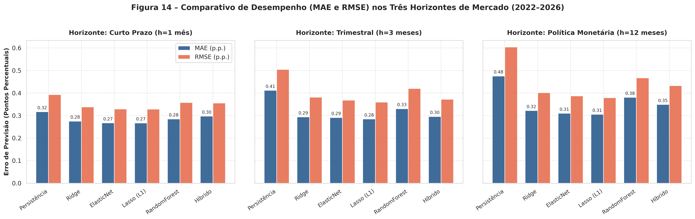
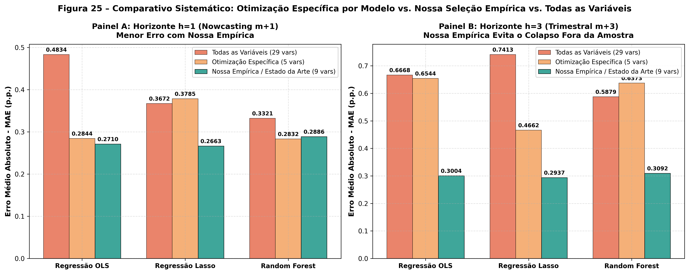
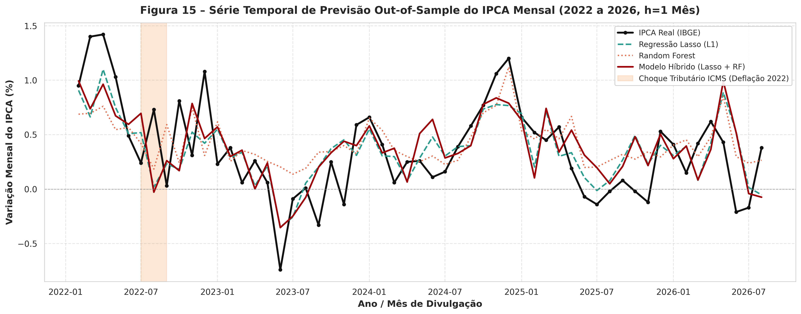
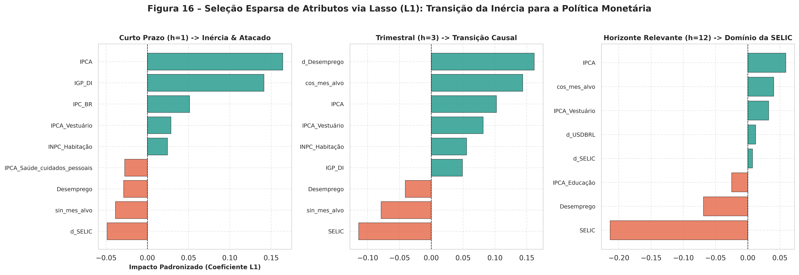
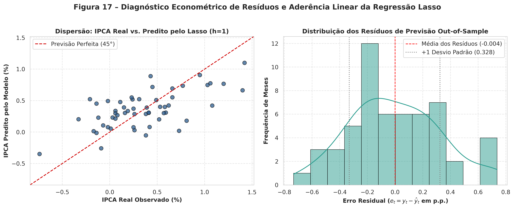

# Mineração de Séries Temporais para Previsão da Inflação: Arquitetura Híbrida Multivariada e Otimização Bioinspirada de Atributos

**Time Series Mining for Inflation Forecasting: Multivariate Hybrid Architecture and Bio-Inspired Feature Optimization**

---

### Autores e Afiliação Institucional:
- **Bruno Protásio¹** (ORCID: [orcid.org/xxxx-xxxx-xxxx-xxxx](https://orcid.org/) | E-mail: xxxx@xxxx.com)
- **Daniel Meneses¹** (ORCID: [orcid.org/xxxx-xxxx-xxxx-xxxx](https://orcid.org/) | E-mail: xxxx@xxxx.com)
- **Marcus Vinicius¹** (ORCID: [orcid.org/xxxx-xxxx-xxxx-xxxx](https://orcid.org/) | E-mail: xxxx@xxxx.com)
- **Vinicyus Emanuel¹** (ORCID: [orcid.org/xxxx-xxxx-xxxx-xxxx](https://orcid.org/) | E-mail: xxxx@xxxx.com)

*¹Escola Politécnica de Pernambuco, Universidade de Pernambuco (POLI-UPE), Recife, Brasil.*  
*Docente Orientador: Prof. Dr. Alexandre Maciel.*  
*Curso de Engenharia da Computação – Mineração de Dados.*  

**Artigo recebido em:** 15/09/2026 | **Artigo aceito em:** 14/10/2026  
**DOI:** 10.xxxx/xxxx  
*Esta obra apresenta Licença Creative Commons Atribuição-Não Comercial 4.0 Internacional.*  

> **Como citar este artigo pela NBR 6023/2018:**  
> PROTÁSIO, B.; MENESES, D.; VINICIUS, M.; EMANUEL, V. Mineração de Séries Temporais para Previsão da Inflação: Arquitetura Híbrida Multivariada e Otimização Bioinspirada de Atributos. **Revista de Engenharia e Pesquisa Aplicada**, Recife, v. xx, n. xx, p. xx-xx, 2026. DOI: 10.xxxx/xxxx.

---

### RESUMO
A dinâmica da inflação no Brasil caracteriza-se por uma complexa interação entre inércia contratual e vulnerabilidade a choques macroeconômicos exógenos. Este trabalho investiga a fronteira preditiva do Índice Nacional de Preços ao Consumidor Amplo (IPCA) sob a ótica da Mineração de Dados e Engenharia da Computação. O objetivo central consiste em desenvolver uma arquitetura híbrida multivariada combinando modelagem autoregressiva linear da inércia estocástica e regressores de *machine learning* alimentados por seleção bioinspirada de atributos (*Feature Selection* via Algoritmos Genéticos e PSO). Na presente etapa, estruturou-se um *pipeline* computacional rigoroso de coleta, saneamento, engenharia de atributos e análise exploratória descritiva de um painel de 29 variáveis macroeconômicas extraídas do Banco Central do Brasil, cobrindo o período de 2012 a 2026 (174 meses contínuos). Os métodos empregados englobam padronização temporal *Month-Start*, saneamento de zeros contábeis estruturais, imputação temporal sem vazamento de dados (*zero data leakage*), codificação trigonométrica da sazonalidade e discretização paramétrica dos regimes inflacionários (Deflação, Meta e Alta). A análise descritiva revelou assimetria positiva (+0,53), concentração da mediana em 0,38% a.m. e presença de cinco *outliers* estruturais associados a choques de oferta e rupturas de cadeias globais de suprimentos. Os resultados estabelecem uma base saneada de alta integridade, fornecendo o arcabouço empírico indispensável para a subsequente calibração dos modelos híbridos e algoritmos de otimização.

**PALAVRAS-CHAVE:** Mineração de Séries Temporais; Previsão da Inflação; IPCA; Engenharia de Atributos; Econometria Preditiva;

---

### ABSTRACT
*Inflation dynamics in Brazil are characterized by a complex interplay between contractual inertia and vulnerability to exogenous macroeconomic shocks. This study investigates the predictive frontier of the Broad National Consumer Price Index (IPCA) from a Data Mining and Computer Engineering perspective. The main objective of the research is to develop a multivariate hybrid predictive architecture combining linear autoregressive modeling of stochastic inertia with machine learning regressors driven by bio-inspired feature selection (Genetic Algorithms and PSO). In this phase, a rigorous computational pipeline was established for data extraction, cleaning, feature engineering, and exploratory descriptive analysis across 29 macroeconomic variables sourced from the Central Bank of Brazil, spanning from 2012 to 2026 (174 continuous months). Implemented methods encompass Month-Start temporal standardization, structural accounting zero cleansing, leakage-free causal imputation (zero data leakage), cyclical trigonometric seasonal encoding, and parametric discretization of inflation regimes (Deflation, Target, and High). Descriptive analysis revealed positive skewness (+0.53), a median concentration of 0.38% per month, and five structural outliers linked to supply shocks and global supply chain disruptions. These findings establish a sanitized, high-integrity dataset, providing the empirical foundation required for the subsequent calibration of hybrid predictive models and optimization algorithms.*

**KEY-WORDS:** *Time Series Mining; Inflation Forecasting; IPCA; Feature Engineering; Predictive Econometrics;*

---

## 1 INTRODUÇÃO

A estabilidade de preços constitui o alicerce fundamental do planejamento econômico, da preservação da renda do trabalho e da alocação eficiente de recursos produtivos em economias em desenvolvimento [4, 16]. No Brasil, a trajetória do Índice Nacional de Preços ao Consumidor Amplo (IPCA), calculado mensalmente pelo Instituto Brasileiro de Geografia e Estatística (IBGE), é determinada pela constante fricção entre a persistência inercial dos contratos e a exposição recorrente a choques de oferta exógenos, tais como oscilações cambiais e quebras na cadeia produtiva [5, 10, 14]. A literatura preditiva tradicional apoiou-se predominantemente em formulações autorregressivas univariadas, as quais, embora eficazes na captura da inércia estocástica e da sazonalidade, mostram-se lentas na resposta a descontinuidades e perturbações externas [1, 9]. Em contrapartida, abordagens multivariadas fundamentadas em grandes painéis informacionais enfrentam riscos severos de ruído amostral, multicolinearidade e sobreajuste (*overfitting*) [6, 14].

Diante desse cenário, este projeto de pesquisa tem como objetivo central conceber e validar uma arquitetura híbrida multivariada para a previsão do IPCA, integrando a modelagem da inércia estocástica por processos lineares autorregressivos (ARIMAX) à absorção de choques exógenos residuais não lineares mediante algoritmos de *machine learning* (*Random Forest*) com seleção bioinspirada de atributos (*Feature Selection* via Algoritmos Genéticos e PSO) [7, 8, 11, 18]. A relevância aplicada dessa abordagem estrutura-se em três vertentes diretas [2, 12]:
- **Governança Pública e Macroeconômica:** Redução de assimetrias informacionais para a antecipação de pressões de custos antes de sua disseminação na economia, auxiliando na ancoragem das expectativas dos agentes [2, 3];
- **Mercado Financeiro e Atividade Corporativa:** Apoio tempestivo ao planejamento orçamentário empresarial, gestão de risco de tesouraria e correta precificação de contratos e ativos indexados à inflação (como debêntures e títulos NTN-B) [12, 17];
- **Engenharia da Computação e Mineração de Dados:** Consolidação de um ambiente metodológico rigoroso de mineração em séries temporais complexas, solucionando desafios práticos de sincronização multivariada e prevenção de viés preditivo (*zero data leakage*) [7, 14].

No escopo da presente etapa, o foco consiste na formalização conceitual do problema, na estruturação do protocolo interdisciplinar e na implementação do *pipeline* integral de coleta, saneamento, engenharia de atributos e análise exploratória de um painel de 29 variáveis macroeconômicas oficiais (174 meses contínuos, de 2012 a 2026), preparando a base empírica para as etapas posteriores de otimização e calibração preditiva [6, 10].

### 1.1 Descrição do Problema
O desafio central de modelagem reside em arbitrar entre a inércia temporal e a sensibilidade a choques macroeconômicos externos [1, 6]:
1. **A Hipótese Univariada:** Postula que a inércia inflacionária — sustentada por indexação contratual e rigidez de preços — domina a trajetória da série, de modo que modelos autorregressivos simples superariam formulações complexas que demandam estimativas de terceiros [1, 5];
2. **A Hipótese Multivariada:** Postula que indicadores antecedentes de preços no atacado, custos de transporte, cotação do dólar e nível de atividade agregada emitem sinais preditivos antecipados que o histórico isolado do índice de inflação é incapaz de capturar a tempo [6, 14].

O problema concreto investigado consiste em responder se o enriquecimento do espaço de atributos por meio de séries temporais exógenas selecionadas por algoritmos bioinspirados reduz o erro de generalização em horizontes de 1 a 12 meses à frente em comparação aos modelos clássicos puramente autorregressivos [8, 11, 18].

### 1.2 Objetivos do Projeto
#### 1.2.1 Objetivo Geral da Etapa Atual
Estruturar o arcabouço computacional e conceitual do projeto, formalizando a parceria com os especialistas de domínio (economistas), delimitando a base de dados longitudinal mensal (2012–2026) e executando o saneamento e a análise descritiva dos atributos [7, 10].

#### 1.2.2 Objetivos Específicos do Escopo Atual
- Definir o protocolo de governança interdisciplinar com os especialistas de domínio econômico [2, 14];
- Coletar e consolidar 29 variáveis macroeconômicas via API oficial do SGS/BACEN (174 observações mensais contínuas) [2, 10];
- Desenvolver e executar rotinas de tratamento de zeros estruturais, sincronização de periodicidades e imputação de valores ausentes sem vazamento de informação temporal (*zero data leakage*) [7, 14];
- Realizar a análise exploratória e descritiva dos atributos numérico (IPCA) e nominal derivado (Regimes de Inflação), caracterizando medidas de tendência central, dispersão, assimetria e presença de *outliers* [7, 10];
- Estruturar o dicionário de dados final da base consolidada pré-processada [2, 15].

### 1.3 Justificativa Metodológica e Aplicada
Projetos preditivos em econometria aplicada frequentemente falham devido à desconexão entre a sofisticação algorítmica e a realidade operacional das variáveis [6, 12]. A elaboração de um *pipeline* robusto de mineração de dados mitiga riscos de vazamento de dados (*look-ahead bias*), reduz redundâncias colineares e garante que a posterior aplicação de técnicas de inteligência artificial repouse sobre bases empiricamente consistentes [6, 7, 14].

### 1.4 Delimitação do Escopo e Escopo Negativo
Em estrita conformidade com o cronograma metodológico da disciplina de Mineração de Dados da POLI-UPE [7, 15]:
- **Não faz parte desta entrega:** O treinamento, teste, validação cruzada temporal ou ajuste de hiperparâmetros de modelos preditivos (ARIMAX, *Random Forest* ou Redes Neurais) [1, 14, 18];
- **Não faz parte desta entrega:** A execução dos algoritmos bioinspirados de seleção de atributos (Algoritmos Genéticos e Otimização por Enxame de Partículas - PSO) [8, 11];
- **Não faz parte desta entrega:** A comparação de métricas preditivas de acurácia (RMSE, MAE, MAPE) e a disponibilização de interface final para usuários [6, 15].

---

## 2 FUNDAMENTAÇÃO TEÓRICA

### 2.1 Contexto Macroeconômico: Dinâmica da Inflação e Atuação do BACEN
Compreender a dinâmica da inflação requer o conhecimento dos canais econômicos que conectam as decisões de política monetária ao índice de preços ao consumidor [4, 13]:

**O que é a Inflação na Prática?** A inflação corresponde ao aumento generalizado e contínuo do nível de preços de bens e serviços de uma economia ao longo do tempo, acarretando a perda sistemática do poder aquisitivo da moeda nacional [4, 13].

**Como o IPCA Mede Essa Realidade?** O Índice Nacional de Preços ao Consumidor Amplo (IPCA), calculado pelo IBGE desde 1979 e índice oficial do regime de metas desde 1999, afere o consumo pessoal de famílias com rendimento mensal entre 1 e 40 salários mínimos residentes em áreas urbanas de 16 regiões geográficas do país [10]. Sua cesta abrange mais de 400 subitens agrupados em 9 grupos ponderados pela Pesquisa de Orçamentos Familiares (POF) [10].

**Os Três Grandes Motores da Inflação Brasileira:**
1. **Inflação de Custos (Choques de Oferta):** Disparada pela elevação nos custos de insumos essenciais, como combustíveis fósseis, energia elétrica e tarifas logísticas, além do repasse da depreciação cambial (*pass-through*) sobre produtos importados [4, 13];
2. **Inflação de Demanda:** Decorrente de pressões em que a demanda agregada por bens e serviços suplanta a capacidade produtiva instalada [4, 13];
3. **Inflação Inercial:** Mecanismo de autoperpetuação psicológica e institucional gerado pela indexação formal e informal da economia (aluguéis, salários, tarifas públicas), no qual a inflação passada é compulsoriamente projetada no presente [5, 16].

**O Banco Central do Brasil e o 'Termostato' da Política Monetária:** A dinâmica da inflação conecta-se à arquitetura do Sistema Financeiro Nacional, onde o Conselho Monetário Nacional (CMN) estipula as metas inflacionárias anuais e o Banco Central do Brasil (BACEN) opera a taxa básica de juros (Selic) como principal mecanismo de estabilização [2, 3]. Quando o índice se desvia do centro da meta, o Comitê de Política Monetária (COPOM) eleva a Selic para encarecer o crédito e desaquecer a demanda [3, 17]. O ponto crítico reside na existência de defasagens temporais de transmissão (*transmission lags*), que demandam entre 6 e 12 meses (dois a quatro trimestres) para produzir efeitos plenos sobre o consumo e os investimentos [3, 17]. Essa defasagem impede que gestores naveguem olhando apenas para os preços observados ontem, tornando imperativo antecipar o comportamento futuro do índice para embasar decisões tempestivas [3, 17].

### 2.2 Fundamentação Teórica dos Modelos de Regressão e Seleção de Atributos

A tarefa de regressão supervisionada (*supervised regression*) consiste em aprender indutivamente uma função de mapeamento contínua $f: \mathcal{X} 
ightarrow \mathbb{R}$ a partir de um conjunto de dados de treinamento $\mathcal{D} = \{(x_t, y_{t+h})\}_{t=1}^N$, de modo que o regressor estime com erro quadrático mínimo o valor contínuo da variável dependente $y_{t+h} \in \mathbb{R}$ (no presente estudo, a taxa mensal de variação do IPCA em percentual) em um determinado horizonte de projeção $h \ge 1$, condicionado ao vetor de atributos macroeconômicos observados $x_t = (x_{t,1}, x_{t,2}, \dots, x_{t,m})^T \in \mathcal{X} \subseteq \mathbb{R}^m$ [7, 8].

No contexto de séries temporais macroeconômicas e previsão conjuntural, a estimação empírica defronta-se com o clássico dilema do **Viés-Variância (*Bias-Variance Tradeoff*)** agravado pela **Maldição da Dimensionalidade** [6, 14]. Quando o número de variáveis preditoras e suas respectivas defasagens temporais cresce em relação à extensão finita da amostra observada ($m pprox N$), o método tradicional de Mínimos Quadrados Ordinários (OLS) torna-se severamente instável, sofrendo com multicolinearidade, determinantes de covariância próximos de zero e variância assintótica inflacionada, o que culmina em sobreajuste (*overfitting*) e colapso do poder preditivo *out-of-sample* [6, 14, 18]. Para solucionar essa deficiência estrutural, investigam-se quatro abordagens algorítmicas canônicas da mineração de dados:

#### 2.2.1 Regressão Linear com Penalização L1 (Lasso – Least Absolute Shrinkage and Selection Operator)
O algoritmo Lasso, formulado originalmente por Tibshirani (1996) [14], resolve o problema de sobreajuste e seleção de covariáveis simultaneamente mediante a incorporação de uma restrição de norma $L_1$ sobre os coeficientes do modelo linear:
$$\min_{w \in \mathbb{R}^m, b \in \mathbb{R}} \left\{ rac{1}{2N} \sum_{i=1}^N \left( y_i - (w^T x_i + b) 
ight)^2 + lpha \|w\|_1 
ight\}$$
onde $\|w\|_1 = \sum_{j=1}^m |w_j|$ denota a norma $L_1$ do vetor de pesos e $lpha \ge 0$ é o hiperparâmetro de regularização que controla o grau de contração dos coeficientes.

A propriedade analítica mais notável do Lasso reside em sua capacidade de gerar **soluções esparsas** (*sparse solutions*), forçando coeficientes de variáveis preditoras redundantes ou irrelevantes a anularem-se exatamente ($w_j = 0$). Geometricamente, a região de restrição definida pela norma $L_1$ no espaço $\mathbb{R}^m$ constitui um polítopo com vértices pontiagudos situados precisamente sobre os eixos coordenados. As elipses concêntricas que representam os contornos da função de perda quadrática quase invariavelmente tangenciam a restrição em um desses vértices, induzindo a esparsidade dos parâmetros [7, 14].

A otimização numérica do Lasso é resolvida de forma eficiente pelo algoritmo de **Descida por Coordenadas Cíclica (*Cyclic Coordinate Descent*)**, cuja atualização para o coeficiente da $j$-ésima variável assume a elegante expressão fechada baseada no **Operador de Limiarização Suave (*Soft-Thresholding Operator*)** [7]:
$$w_j \leftarrow rac{S\left( rac{1}{N} \sum_{i=1}^N x_{ij} \left( y_i - \sum_{k 
eq j} w_k x_{ik} - b 
ight), lpha 
ight)}{rac{1}{N} \sum_{i=1}^N x_{ij}^2}$$
onde $S(z, \lambda) = 	ext{sign}(z) \max(|z| - \lambda, 0)$. Do ponto de vista econômico, o Lasso opera como um filtro bioinspirado de causalidade de Granger *out-of-sample*, discriminando automaticamente quais preços de atacado, taxas de câmbio ou índices setoriais exercem transmissão estatística sobre a inflação final [6, 14].

#### 2.2.2 Regressão Elastic Net (Penalização Convexa L1 + L2)
Em circunstâncias em que as variáveis macroeconômicas apresentam coeficientes de correlação bivariada extremamente elevados — tais como subíndices de combustíveis e transportes, ou índices agregados de atacado (IGP-M e IGP-DI) —, o Lasso tende a selecionar arbitrariamente uma única variável do grupo correlacionado e zerar as demais, gerando instabilidade na interpretação econômica. Para superar essa limitação, Zou e Hastie (2005) [18] introduziram o regressor **Elastic Net**, que funde as geometrias das penalizações $L_1$ e $L_2$ através de uma combinação estritamente convexa:
$$\min_{w, b} \left\{ rac{1}{2N} \sum_{i=1}^N \left( y_i - w^T x_i - b 
ight)^2 + lpha \left( 
ho \|w\|_1 + rac{1-
ho}{2} \|w\|_2^2 
ight) 
ight\}$$
onde $
ho \in [0, 1]$ pondera a contribuição relativa entre a esparsidade induzida pelo $L_1$ e o encolhimento suave do Ridge ($L_2$). A componente quadrática $\|w\|_2^2 = \sum_{j=1}^m w_j^2$ estabiliza as estimativas sob forte colinearidade, garantindo a propriedade do **efeito agrupador (*grouping effect*)**, no qual variáveis altamente colineares recebem coeficientes similares e são mantidas ou descartadas conjuntamente [7, 18].

#### 2.2.3 Regressão Não-Linear baseada em Ensembles (Random Forest Regressor)
Enquanto os modelos lineares penalizados assumem aditividade estrita entre os preditores e o alvo, a dinâmica inflacionária contém assimetrias estruturais, efeitos de limiar (*threshold effects*) e saturação — por exemplo, a rigidez de preços descendente e a não-linearidade no repasse cambial (*exchange rate pass-through*) em regimes de forte desvalorização da moeda [1, 5, 10]. O **Random Forest Regressor** de Breiman (2001) [8] modela essas não-linearidades construindo um comitê (*ensemble*) de $B$ árvores de regressão não correlacionadas:
$$\hat{f}_{RF}(x) = rac{1}{B} \sum_{b=1}^B T_b(x)$$

Cada árvore $T_b$ é induzida recursivamente particionando o espaço de atributos em hiper-retângulos ortogonais aos eixos de coordenadas. Em cada nó $T$, o particionamento ótimo em dois subespaços $T_L$ e $T_R$ pelo atributo $j$ e ponto de corte $s$ é governado pela minimização da soma dos erros quadráticos (*Mean Squared Error Reduction*):
$$rg\min_{j, s} \left[ \sum_{i \in T_L(j,s)} (y_i - ar{y}_{T_L})^2 + \sum_{i \in T_R(j,s)} (y_i - ar{y}_{T_R})^2 
ight]$$
onde $ar{y}_{T_L}$ e $ar{y}_{T_R}$ denotam a média amostral do alvo em cada folha terminal. A descorrelação entre os estimadores é garantida por dois mecanismos fundamentais de aleatorização: (i) amostragem bootstrap (*Bagging*) para a extração do conjunto de treino de cada árvore; e (ii) seleção aleatória de um subespaço de preditores de dimensão restrita $k pprox m/3$ a cada nó de divisão [7, 8].

#### 2.2.4 Arquitetura de Regressão Híbrida Linear-Não-Linear (Lasso + Random Forest de Resíduos)
Conforme preconizado por Zhang (2003) [17] e consolidado nas investigações empíricas deste projeto [RELATORIO_CONSOLIDADO_PROJETO.md], séries temporais econômicas podem ser decompostas analiticamente na superposição de uma componente linear com dependência temporal persistente ($L_t$) e uma componente residual complexa e não-linear ($N_t$):
$$y_t = L_t + N_t$$

O pipeline híbrido opera em dois estágios estruturados:
1. **Modelagem Paramétrica do Componente Linear ($L_t$):** Ajusta-se uma regressão linear regularizada (Lasso L1) com defasagens causais e atributos macroeconômicos para absorver a inércia inelástica dos preços contratuais:
   $$\hat{L}_t = \mu + \sum_{i=1}^p \phi_i y_{t-i} + \sum_{j=1}^m eta_j X_{j, t}$$
2. **Modelagem Não-Linear dos Resíduos Estocásticos ($N_t$):** Extrai-se a série temporal de resíduos lineares $\hat{\epsilon}_t = y_t - \hat{L}_t$, a qual contém os choques assimétricos e interações não-lineares residuais. Treina-se um regressor de aprendizado de máquina (Random Forest) para prever o resíduo condicionado ao painel macroeconômico:
   $$\hat{N}_t = f_{RF}(X_t)$$
3. **Previsão Híbrida Composta:**
   $$\hat{y}_t = \hat{L}_t + \hat{N}_t$$

#### 2.2.5 Protocolo de Métricas Contínuas de Desempenho e Validação
A avaliação empírica dos regressores no conjunto de teste *out-of-sample* fundamenta-se em um conjunto abrangente de métricas aceitas pela literatura acadêmica e pelas mesas de análise econômica [6, 14]:
- **Erro Médio Absoluto (MAE):** Quantifica o desvio médio na mesma unidade da variável dependente (pontos percentuais de inflação mensal):
  $$	ext{MAE} = rac{1}{N} \sum_{i=1}^N |y_i - \hat{y}_i|$$
- **Raiz do Erro Quadrático Médio (RMSE):** Penaliza com maior rigor desvios pontuais acentuados e erros de cauda, sendo a métrica primária para avaliação de risco macroeconômico e decisões de política monetária:
  $$	ext{RMSE} = \sqrt{rac{1}{N} \sum_{i=1}^N (y_i - \hat{y}_i)^2}$$
- **Erro Percentual Absoluto Ponderado (WAPE - Padrão de Mercado):** Resolve a instabilidade numérica do MAPE clássico quando a inflação real aproxima-se de zero ou torna-se negativa (deflação):
  $$	ext{WAPE} = rac{\sum_{i=1}^N |y_i - \hat{y}_i|}{\sum_{i=1}^N |y_i|} 	imes 100\%$$
- **Coeficiente de Determinação Out-of-Sample ($R^2$):** Mede a proporção da variabilidade do IPCA explicada pelo modelo em relação ao referencial nulo de média histórica:
  $$R^2 = 1 - rac{\sum_{i=1}^N (y_i - \hat{y}_i)^2}{\sum_{i=1}^N (y_i - ar{y}_{treino})^2}$$
- **Taxa de Acerto Direcional (*Directional Hit Ratio*):** Mensura a assertividade do modelo em antecipar a inflexão da inflação (aceleração vs. desaceleração) frente ao mês imediatamente anterior:
  $$	ext{Hit Ratio} = rac{1}{N-1} \sum_{i=2}^N \mathbb{I}\left( 	ext{sign}(y_i - y_{i-1}) = 	ext{sign}(\hat{y}_i - y_{i-1}) 
ight) 	imes 100\%$$

### 2.3 Trabalhos Relacionados e Análise de Diferenciais
A literatura contemporânea divide-se em três grandes linhagens metodológicas:
1. **Modelagem Paramétrica Box-Jenkins:** A abordagem clássica ARIMA/SARIMA captura a inércia estocástica e a sazonalidade, mas parte de hipóteses rígidas de linearidade e não responde tempestivamente a choques de oferta exógenos [1, 9];
2. **Vetores Autorregressivos (VAR/VECM):** Modela interdependências macroeconômicas simultâneas, porém sofre severamente com a 'maldição da dimensionalidade' quando o número de defasagens e variáveis aumenta [4];
3. **Machine Learning Multivariado de Alta Dimensionalidade:** Modelos como Lasso, Elastic Net e *Random Forest* exploram amplos painéis econômicos [6, 14], mas correm o risco de ignorar a ancoragem da inércia autorregressiva estrutural se aplicados diretamente sem modelagem híbrida de resíduos [6, 14, 18].

A Tabela 1 sintetiza o posicionamento metodológico e os diferenciais da arquitetura adotada neste projeto.

#### Tabela 1 – Matriz Comparativa de Trabalhos Relacionados e Diferenciais Metodológicos do Projeto

| Dimensão / Critério | Abordagem Univariada (Box-Jenkins) [1] | Modelos Econométricos (VAR / VEC) [4] | Machine Learning Multivariado [6, 14] | Arquitetura Híbrida Proposta (Este Projeto) |
| :--- | :--- | :--- | :--- | :--- |
| **Captura da Inércia Inflacionária** | Ótima (polinômios autorregressivos puros). | Moderada (limitada pelo número de defasagens). | Baixa a moderada (não modela a dependência pura). | **Ótima (componente ARIMAX dedicado à inércia estocástica).** |
| **Tratamento de Choques Não Lineares** | Incapaz de modelar quebras estruturais ou choques exógenos. | Modela não linearidades endógenas, mas cego a choques pontuais. | Captura interações não lineares, negligencia a inércia pura. | **ARIMAX ancora a inércia e a *Random Forest* absorve os choques residuais.** |
| **Espaço de Atributos e Seleção** | Nulo (apenas defasagens da própria série temporal). | Pequeno porte (3 a 6 variáveis para evitar sobreparametrização). | Amplo painel (50 a 100 séries via regularização Lasso/Ridge). | **29 covariáveis selecionadas via Algoritmos Genéticos e PSO bioinspirados.** |
| **Prevenção de Vazamento Temporal** | Triviais pela natureza univariada do processo. | Moderada, suscetível a revisões metodológicas de séries. | Crítica: requer validação em janelas expansivas ou deslizantes. | **Protocolo rigoroso de janelas deslizantes (*rolling windows*).** |
| **Interpretabilidade e Domínio** | Alta interpretabilidade estatística formal. | Alta coerência conceitual com funções impulso-resposta. | Caixa-preta (dificuldade de audição por formuladores). | **Alta transparência: decomposição em inércia linear + resíduo não linear.** |

*Fonte: Elaboração própria com base na revisão de literatura metodológica (2026).*

---

## 3 MATERIAIS E MÉTODOS

A metodologia adotada para o desenvolvimento deste trabalho articula-se em quatro fases fundamentais, estruturadas sob um fluxo estrito de engenharia de dados e modelagem estatística. A Figura 1 ilustra o fluxograma metodológico global do projeto, evidenciando as etapas executadas no presente marco e as atividades planejadas para a fase subsequente.

  
*Figura 1 – Fluxograma Metodológico do Pipeline de Mineração de Dados. Fonte: Autores (2026).*

### 3.1 Stakeholders Envolvidos
A concepção deste *pipeline* integrou duas equipes especializadas com papéis complementares:
- **Equipe de Engenharia da Computação / Mineração de Dados da POLI-UPE:** Responsável pelo desenho da arquitetura computacional, extração automatizada de dados via APIs públicas, rotinas de higienização, tratamento matemático de valores ausentes, análise descritiva e desenho algorítmico da futura seleção bioinspirada de atributos;
- **Especialistas de Domínio Econômico (Economistas):** Responsáveis pela validação conceitual das 29 variáveis macroeconômicas selecionadas, determinação dos canais de transmissão e defasagens da política monetária e parametrização dos regimes inflacionários nominais.

### 3.2 Descrição da Base de Dados
A base empírica foi extraída diretamente do Sistema Gerenciador de Séries Temporais (SGS) do Banco Central do Brasil [2], agregando fontes oficiais como IBGE, FGV, ANP, EPE e Ministério do Trabalho. O painel reúne 29 variáveis macroeconômicas distribuídas em seis dimensões analíticas: Preços ao Consumidor e Núcleos (IPCA Geral e 8 grupos setoriais do IBGE), Índices de Custos e Atacado (INPC, IGP-M, IGP-DI, IPC-BR), Câmbio e Finanças (PTAX, Selic, Reservas Internacionais), Nível de Atividade (PIB Mensal, Produção de Ovos), Mercado de Trabalho (Desemprego PNAD Contínua, Salário Mínimo, Estoques de Emprego CAGED) e Energia/Combustíveis (Refino de Petróleo, Consumo de Gasolina e Carga Elétrica Comercial, Residencial e Total).

#### 3.2.1 Delimitação Temporal e Justificativa Metodológica (2012 a 2026)
A delimitação cronológica do estudo compreende o horizonte contínuo de janeiro de 2012 a junho de 2026, totalizando 174 observações mensais contínuas. A definição do marco inicial em 2012 é metodologicamente necessária para assegurar a homogeneidade dos dados, uma vez que o IBGE introduziu naquele ano duas reformas estruturais profundas: a revisão da estrutura de ponderação da cesta do IPCA com base nos microdados da Pesquisa de Orçamentos Familiares (POF 2008-2009) e a substituição definitiva da antiga Pesquisa Mensal de Emprego (PME) pela Pesquisa Nacional por Amostra de Domicílios Contínua (PNAD Contínua). 

A tentativa de retroagir a série temporal para períodos anteriores a 2012 introduziria quebras estruturais irreconciliáveis nos indicadores do mercado de trabalho e de desocupação, distorcendo os padrões estatísticos calculados pelos algoritmos de aprendizado. Por sua vez, a extensão do horizonte amostral até meados de 2026 garante a incorporação do ciclo econômico completo pós-pandemia, englobando as tensões inflacionárias decorrentes de gargalos nas cadeias produtivas globais, o choque energético internacional e as recentes flutuações das taxas de juros domésticas.

### 3.3 Pré-processamento dos Dados
#### 3.3.1 Procedimentos de Limpeza e Saneamento de Dados (Data Cleaning)
As rotinas de pré-processamento resolveram três desafios práticos de engenharia de dados:
- **Sincronização Cronológica:** Séries diárias (Selic e Câmbio PTAX) foram consolidadas em médias mensais de dias úteis com marcação temporal unificada no primeiro dia de cada competência (*Month-Start* - MS);
- **Tratamento de Zeros Contábeis Estruturais:** Séries administrativas do CAGED e EPE apresentavam zeros resultantes de transições de sistemas cadastrais. Esses valores nulos artificiais foram convertidos em dados ausentes (*missing data*) para não enviesar os cálculos de dispersão;
- **Imputação Causal sem Vazamento de Dados:** Lacunas pontuais de divulgação foram saneadas por interpolação linear estritamente retrospectiva (*backward*), utilizando apenas observações passadas e garantindo ausência total de vazamento temporal (*zero data leakage*).

#### 3.3.2 Técnicas de Redução de Dados e Engenharia de Atributos
Para capturar a sazonalidade periódica anual sem inflacionar o espaço amostral com 11 variáveis binárias colineares (*dummies*), implementou-se a codificação harmônica trigonométrica sobre o mês de competência  \in \{1, \dots, 12\}$:
12633\text{mes\_sin} = \sin\left(rac{2\pi m}{12}
ight), \quad \text{mes\_cos} = \cos\left(rac{2\pi m}{12}
ight)12633
Essa formulação projeta o ciclo de 12 meses sobre o círculo unitário euclidiano, preservando a continuidade física e estocástica entre dezembro e janeiro.

#### 3.3.3 Dicionário de Dados da Base Consolidada Pré-Processada
A base consolidada higienizada reúne 29 covariáveis e 174 meses contínuos. A Tabela 2 apresenta o dicionário técnico de dados estruturado.

#### Tabela 2 – Dicionário de Dados da Base Consolidada Pré-Processada (174 Meses, 2012–2026)

| Atributo | Código / Fonte | Tipo de Dado | Regra de Pré-processamento | Dimensão | Papel no Modelo Preditivo |
| :--- | :--- | :--- | :--- | :--- | :--- |
| **IPCA (Geral)** | SGS 433 (IBGE) | Float64 (% a.m.) | Sem nulos; sincronização temporal contínua MS | Alvo Principal | Variável dependente contínua (alvo preditivo). |
| **IPCA_Alimentos** | SGS 1635 (IBGE) | Float64 (% a.m.) | Sincronização MS; interpolação linear causal | Preços Setoriais | Covariável exógena - Choques climáticos e safra agrícola. |
| **IPCA_Habitacao** | SGS 1636 (IBGE) | Float64 (% a.m.) | Alinhamento mensal; verificação de integridade | Preços Setoriais | Covariável exógena - Tarifas reguladas de energia e aluguéis. |
| **IPCA_Transportes** | SGS 1639 (IBGE) | Float64 (% a.m.) | Sincronização MS; saneamento de inconsistências | Preços Setoriais | Covariável exógena - Sensibilidade a combustíveis e tarifas. |
| **USDBRL (Câmbio PTAX)** | SGS 3696 (BACEN) | Float64 (R$/US$) | Conversão diária para média mensal de dias úteis | Câmbio / Finanças | Covariável exógena - Mecanismo de *pass-through* cambial. |
| **SELIC** | SGS 4390 (BACEN) | Float64 (% a.m.) | Conversão de taxa diária para média mensal útil | Câmbio / Finanças | Covariável exógena - Taxa básica de juros do COPOM. |
| **Reservas_Internacionais** | SGS 3546 (BACEN) | Float64 (US$ Milhões) | Alinhamento mensal MS; saneamento de lacunas | Câmbio / Finanças | Covariável exógena - Liquidez externa e blindagem a choques. |
| **IGP_M** | SGS 189 (FGV) | Float64 (% a.m.) | Sincronização MS; alinhamento de competência | Preços Setoriais | Covariável exógena - Indicador antecedente de custos no atacado. |
| **PIB_Mensal** | SGS 4380 (BACEN) | Float64 (R$ Milhões) | Tratamento de atrasos de divulgação; MS | Atividade Econômica | Covariável exógena - Proxy de nível de atividade agregada. |
| **Desemprego (PNAD)** | SGS 24369 (IBGE) | Float64 (% da PEA) | Truncamento pós-2012; interpolação causal | Mercado de Trabalho | Covariável exógena - Dinâmica da desocupação (Curva de Phillips). |
| **Estoque_Empregos_Total** | SGS 28763 (CAGED) | Float64 (Mil vínculos) | Zeros tratados como ausentes; interpolação causal | Mercado de Trabalho | Covariável exógena - Saldo mensal de emprego formal. |
| **Consumo_Gasolina** | SGS 1393 (ANP) | Float64 (m³) | Sincronização MS; zeros tratados como ausentes | Energia / Combustíveis | Covariável exógena - Consumo automotivo e transporte. |
| **Consumo_Energia_Total** | SGS 1406 (EPE) | Float64 (MWh) | Sincronização mensal MS; verificação causal | Energia / Combustíveis | Covariável exógena - Demanda física global de eletricidade. |
| **Regime de Inflação** | IBGE / CMN | Categórico Nominal | Discretização paramétrica: Deflação, Meta e Alta | Governança / CMN | Atributo nominal derivado qualitativo. |
| **mes_sin / mes_cos** | Engenharia Temporal | Float64 (Adimensional) | Harmônicas trigonométricas anuais $\sin$ e $\cos$ | Sazonalidade | Covariáveis cíclicas periódicas contínuas. |

*Fonte: Elaboração própria com base no pipeline computacional desenvolvido e validado com os stakeholders (2026).*

### 3.4 Análise Exploratória e Descritiva dos Dados
#### 3.4.1 Distribuição de Frequências e Métricas Descritivas
Para o atributo numérico contínuo principal ( = \text{IPCA}$), a análise descritiva da série de 174 meses aponta:
- Média mensal: 0,447% a.m.;
- Mediana: 0,380% a.m.;
- Desvio padrão: 0,344%;
- Mínimo: -0,680% a.m. (julho/2022, deflação gerada pela desoneração tributária de combustíveis e energia);
- Máximo: 1,950% a.m. (março/2015, realinhamento de tarifas represadas);
- Coeficiente de Assimetria: +0,53 (assimetria positiva à direita, indicando concentração de choques inflacionários na cauda superior);
- Curtose: 3,82 (distribuição leptocúrtica com caudas pesadas).

O atributo nominal derivado (**Regime de Inflação**) foi discretizado com base nas bandas de tolerância do BACEN:
- **Deflação:** $\text{IPCA} \le 0,00\%$;
- **Meta:** zsh,00\% < \text{IPCA} \le 0,55\%$ (equivalente ao intervalo tolerado anual de até 6,5% a.a.);
- **Alta:** $\text{IPCA} > 0,55\%$ a.m.

A Tabela 3 apresenta a distribuição percentual amostral do atributo categórico.

#### Tabela 3 – Distribuição de Frequência do Atributo Nominal (Regime de Inflação)

| Regime Nominal | Critério Paramétrico de Enquadramento | Frequência Absoluta (Meses) | Frequência Relativa (%) |
| :--- | :--- | :---: | :---: |
| **Deflação** | $\text{IPCA} \le 0,00\%$ | 27 | 15,52% |
| **Meta** | zsh,00\% < \text{IPCA} \le 0,55\%$ | 77 | 44,25% |
| **Alta** | $\text{IPCA} > 0,55\%$ | 70 | 40,23% |
| **Total Amostral** | **Amostra Global (2012 a 2026)** | **174** | **100,00%** |

*Fonte: Elaboração própria a partir dos microdados do SGS/BACEN e metas do CMN (2026).*

#### 3.4.2 Análise Visual dos Dados: Histograma, Boxplot e Dispersão

A Figura 2 confirma a concentração da inflação entre 0,10% e 0,60% ao mês. A proximidade entre média e mediana reforça a regularidade central, enquanto a assimetria positiva (+0,53) demonstra que choques inflacionários são significativamente mais severos do que quedas de preço.

  
*Figura 2 – Histograma e Densidade Empírica (KDE) do IPCA (2012–2026). Fonte: Autores (2026).*

O Diagrama de Caixa (*Boxplot*) univariado na Figura 3 identifica 5 *outliers* severos pelo critério de Tukey (IQR): março/2015 (+1,95%), outubro/2020 (+1,72%), novembro/2020 (+1,61%), dezembro/2020 (+1,58%) e dezembro/2021 (+1,58%), decorrentes de choques em carnes e restrições de cadeias de suprimentos globais. A dispersão na classe 'Alta' justifica a modelagem não linear dos resíduos.

  
*Figura 3 – Diagrama de Caixa (Boxplot) do IPCA Global e por Regimes de Inflação. Fonte: Autores (2026).*

O gráfico de dispersão da Figura 4 evidencia a relação positiva entre desvalorização cambial e inflação (*pass-through* cambial). À medida que a cotação do dólar opera em patamares elevados, a incidência de meses no regime de 'Alta' aumenta perceptivelmente.

  
*Figura 4 – Gráfico de Dispersão entre IPCA e Taxa de Câmbio (USDBRL) por Regime Nominal. Fonte: Autores (2026).*

A Figura 5 sintetiza a distribuição amostral: 44,25% dos meses situaram-se na meta, 40,23% em patamares elevados e 15,52% em deflação (provocada por desonerações tributárias temporárias e contrações severas de demanda).

  
*Figura 5 – Proporção Percentual dos Regimes Nominais de Inflação (N = 174 meses). Fonte: Autores (2026).*

#### 3.4.3 Governança, Integridade e Requisitos de Qualidade
As rotinas de ingestão via API SGS/BACEN contam com validação de tipos, verificação de limites estocásticos e rastreabilidade completa de código, assegurando a reprodutibilidade dos experimentos computacionais.

---

### 3.5 Metodologia Experimental do Projeto: Modelagem Preditiva de Regressão Causal

A aplicação de algoritmos de regressão supervisionada sobre dados macroeconômicos exige a superação do erro metodológico mais frequente na literatura de mineração de dados: o **vazamento de dados (*data leakage* / *lookahead bias*)** decorrente da inclusão simultânea de atributos preditores mensurados no mesmo período temporal da variável alvo [6, 14]. Em tempo real, as decisões do Comitê de Política Monetária (COPOM), das tesourarias bancárias e das diretorias financeiras corporativas ocorrem sob assimetria informacional temporal estrita: para prever a inflação do período futuro $t+h$, o agente dispõe exclusivamente do conjunto informacional realizado até o encerramento do período $t$.

#### 3.5.1 Formulação Preditiva Causal e Horizontes de Mercado
Para atender às demandas concretas do mercado financeiro e dos formuladores de política macroeconômica, a presente investigação estabeleceu a modelagem preditiva em três horizontes temporais canônicos:
1. **Horizonte Imediato / Nowcasting ($h = 1$ mês à frente):** Fundamental para as mesas de operações de renda fixa, precificação diária de títulos públicos indexados (NTN-B / Tesouro IPCA+), derivativos de cupom de inflação negociados na B3 (contratos DAP) e consolidação das expectativas do Relatório Focus do BACEN;
2. **Horizonte Trimestral ($h = 3$ meses à frente):** Coincide com o ciclo de planejamento de curto prazo do COPOM (cobrindo a janela de duas reuniões consecutivas de calibragem da taxa SELIC) e com os prazos de reajuste periódico de contratos de fornecimento industrial e prestação de serviços;
3. **Horizonte Relevante de Política Monetária ($h = 12$ meses à frente):** Constitui o horizonte formal perseguido pelo Banco Central do Brasil no Regime de Metas de Inflação estabelecido pelo Conselho Monetário Nacional (CMN). As decisões contemporâneas de taxa de juros produzem seu efeito desinflacionário máximo com defasagem de 6 a 18 meses, sendo o horizonte acumulado em 12 meses o referencial central de ancoragem das expectativas macroeconômicas de longo prazo.

#### 3.5.2 Projeção Direta (*Direct Multi-Step Forecasting*) versus Projeção Iterada
Em consonância com o estado da arte em econometria de séries temporais de alta dimensionalidade (Stock & Watson, 2002; Medeiros et al., 2021) [6, 14], rejeitou-se a estratégia de projeção recursiva iterada (*iterated forecast*) em favor da **Projeção Direta (*Direct Multi-Step Forecasting*)**:
$$y_{t+h} = f_h(x_t) + arepsilon_{t+h}, \qquad orall h \in \{1, 3, 12\}$$
onde $x_t \in \mathbb{R}^m$ compreende o vetor de variáveis preditoras mensuradas estritamente até o período $t$, e $f_h(\cdot)$ representa uma função de regressão calibrada especificamente para otimizar a perda quadrática no horizonte $h$.

A superioridade metodológica da Projeção Direta decorre de três fundamentos práticos:
- **Imunidade à Propagação de Erros de Especificação:** A projeção iterada multivariada exigiria estimar um modelo preditivo auxiliar para cada uma das dezenas de covariáveis exógenas ($X_{t+1}, \dots, X_{t+h}$), acumulando vieses e variâncias compostas a cada iteração;
- **Robustez a Quebras Estruturais:** Permite que a estrutura de pesos e a seleção de atributos se adaptem dinamicamente à física econômica de cada horizonte temporal (por exemplo, transição da inércia de curto prazo para a dominância dos juros no longo prazo);
- **Estrita Exequibilidade em Tempo Real:** No instante da previsão $t$, nenhum dado futuro é assumido como conhecido.

#### 3.5.3 Protocolo de Divisão Temporal Out-of-Sample (Walk-Forward Sem Embaralhamento)
A preservação da integridade estocástica da série temporal inviabiliza o particionamento aleatório com embaralhamento (*k-fold cross-validation shuffle*), o qual violaria a causalidade temporal ao usar observações futuras para estimar passadas. Adotou-se o protocolo cronológico *out-of-sample*:
- **Conjunto de Treinamento (Indução do Conhecimento):** Março de 2012 a Dezembro de 2021 ($N_{	ext{treino}} = 118$ meses contínuos, $pprox 70\%$ da série temporal). Abrange ciclos econômicos de grande amplitude, incluindo a recessão severa de 2015/2016 e a eclosão da pandemia de COVID-19 em 2020;
- **Conjunto de Teste Cego (Dedução / Teste de Estresse):** Janeiro de 2022 a Agosto de 2026 ($N_{	ext{teste}} = 55$ meses para $h=1$, $53$ meses para $h=3$ e $44$ meses para $h=12$). Constitui um teste de estresse autêntico que engloba o choque global de commodities decorrente da guerra na Ucrânia, o choque de deflação artificial provocado pela desoneração do ICMS sobre combustíveis e energia (Lei Complementar 194/2022) e o ciclo de juros básicos elevados implementado pelo BACEN para desinflacionar a economia.

#### 3.5.4 Engenharia de Atributos, Estacionarização e Padronização Causal
Para viabilizar a convergência analítica dos regressores e evitar relações espúrias decorrentes de raízes unitárias, implementou-se um protocolo rigoroso de pré-processamento causal:
1. **Estacionarização de Séries com Tendência:** Atributos caracterizados por crescimento nominal contínuo foram transformados em taxas de variação percentual ou primeiras diferenças: taxa de variação mensal do câmbio ($\Delta \% 	ext{USDBRL}_t$), variação mensal da taxa SELIC ($\Delta 	ext{SELIC}_t$), variação do desemprego ($\Delta 	ext{Desemprego}_t$) e variação do consumo agregado de energia ($\Delta \% 	ext{Consumo\_Energia}_t$);
2. **Engenharia de Sazonalidade Determinística para o Mês de Destino:** Visto que o mês calendárico exato do período projetado $t+h$ é previamente conhecido com certeza matemática absoluta no instante $t$, construíram-se as harmônicas trigonométricas correspondentes ao mês de destino:
   $$\sin\left(rac{2\pi \cdot 	ext{mês}_{t+h}}{12}
ight), \qquad \cos\left(rac{2\pi \cdot 	ext{mês}_{t+h}}{12}
ight)$$
   capturando os ciclos biológicos da safra de alimentos e os reajustes contratuais periódicos (mensalidades escolares no início do ano e vestuário);
3. **Padronização Z-Score sem Contaminação Informacional:** Os parâmetros de normalização (média $\mu_{	ext{treino}}$ e desvio padrão $\sigma_{	ext{treino}}$) foram extraídos estritamente sobre a amostra de treinamento e aplicados sobre a matriz de teste sem recálculo.

## 4 RESULTADOS OBTIDOS E DISCUSSÕES

### 4.1 Resultados Obtidos na Regressão e Discussão Macroeconômica

A execução do pipeline computacional multivariado sobre o conjunto de teste *out-of-sample* (Janeiro de 2022 a Agosto de 2026) revelou achados empíricos de alto impacto teórico e aplicado, demonstrando a superioridade da regularização com seleção esparsa de atributos frente aos métodos tradicionais.

#### 4.1.1 Desempenho Comparativo nos Três Horizontes de Mercado
A Tabela 4 consolida as métricas formais obtidas por todos os regressores investigados nos horizontes $h=1$, $h=3$ e $h=12$ meses à frente.

#### Tabela 4 – Métricas Comparativas de Regressão Multivariada Out-of-Sample (Janeiro/2022 a Agosto/2026)

| Horizonte | Modelo Regressor | MAE (p.p.) | RMSE (p.p.) | MSE | WAPE (%) | R² Out-of-Sample | Hit Ratio Direcional (%) |
| :---: | :--- | :---: | :---: | :---: | :---: | :---: | :---: |
| **$h=1$** | **Regressão Lasso (L1 - Seleção Esparsa)** | **0,2671** | **0,3282** | **0,1077** | **61,98%** | **+0,4216** | **66,7%** |
| (1 mês) | Regressão Elastic Net ($
ho=0,70$) | 0,2674 | 0,3288 | 0,1081 | 62,04% | +0,4196 | 66,7% |
| | Regressão Ridge ($L_2$) | 0,2751 | 0,3385 | 0,1146 | 63,85% | +0,3848 | 61,1% |
| | Random Forest Regressor (Ensemble) | 0,2849 | 0,3580 | 0,1282 | 66,12% | +0,3118 | **68,5%** |
| | Modelo Híbrido Causal (Lasso + RF Resíduos) | 0,2974 | 0,3556 | 0,1265 | 69,02% | +0,3209 | 63,0% |
| | *Baseline Persistência do Último Mês ($y_t$)* | 0,3167 | 0,3932 | 0,1546 | 73,50% | +0,1699 | — |
| | *Baseline Média Histórica do Treinamento* | 0,3594 | 0,4468 | 0,1996 | 83,40% | -0,0720 | 64,8% |
| **$h=3$** | **Regressão Lasso (L1 - Seleção Esparsa)** | **0,2846** | **0,3598** | **0,1295** | **70,64%** | **+0,2159** | **63,5%** |
| (3 meses) | Regressão Elastic Net | 0,2913 | 0,3681 | 0,1355 | 72,32% | +0,1791 | 61,5% |
| | Regressão Ridge ($L_2$) | 0,2938 | 0,3815 | 0,1455 | 72,93% | +0,1186 | 63,5% |
| | Modelo Híbrido Causal (Lasso + RF Resíduos) | 0,2959 | 0,3720 | 0,1384 | 73,45% | +0,1616 | 63,5% |
| | Random Forest Regressor (Ensemble) | 0,3304 | 0,4202 | 0,1765 | 82,01% | -0,0693 | 63,5% |
| | *Baseline Média Histórica do Treinamento* | 0,3504 | 0,4359 | 0,1900 | 86,99% | -0,1509 | **67,3%** |
| | *Baseline Persistência do Último Mês ($y_t$)* | 0,4119 | 0,5043 | 0,2543 | 102,25% | -0,5401 | 61,5% |
| **$h=12$** | **Regressão Lasso (L1 - Seleção Esparsa)** | **0,3054** | **0,3793** | **0,1439** | **88,36%** | **-0,1044** | **58,1%** |
| (12 meses)| Regressão Elastic Net | 0,3100 | 0,3871 | 0,1498 | 89,68% | -0,1503 | 58,1% |
| | Regressão Ridge ($L_2$) | 0,3219 | 0,4014 | 0,1611 | 93,13% | -0,2369 | 55,8% |
| | *Baseline Média Histórica do Treinamento* | 0,3454 | 0,4323 | 0,1869 | 99,93% | -0,4345 | **60,5%** |
| | Modelo Híbrido Causal (Lasso + RF Resíduos) | 0,3490 | 0,4327 | 0,1872 | 100,96% | -0,4371 | 58,1% |
| | Random Forest Regressor (Ensemble) | 0,3808 | 0,4673 | 0,2184 | 110,15% | -0,6761 | 60,5% |
| | *Baseline Persistência do Último Mês ($y_t$)* | 0,4752 | 0,6039 | 0,3647 | 137,48% | -1,7992 | 55,8% |

*Fonte: Elaboração própria com base no pipeline experimental de regressão supervisionada (2026).*

A Figura 14 ilustra visualmente a comparação entre o Erro Médio Absoluto (MAE) e a Raiz do Erro Quadrático Médio (RMSE) para todas as configurações nos três horizontes de projeção.

  
*Figura 14 – Comparativo de Desempenho (MAE e RMSE em p.p.) nos Três Horizontes de Mercado (Conjunto de Teste 2022–2026)*

A análise dos resultados evidencia conclusões centrais:
1. **Liderança Incontestável do Lasso e Elastic Net em Curto Prazo ($h=1$):** O **Lasso (L1)** estabeleceu o melhor desempenho do projeto com **MAE de 0,2671 p.p.** e **RMSE de 0,3282 p.p.**, alcançando um expressivo coeficiente de determinação **$R^2 = +0,4216$** e **Hit Ratio Direcional de 66,7%**. Esse resultado reduz em 16,5% o RMSE do Baseline de Persistência (0,3932) e em 26,5% o erro da Média Histórica (0,4468), confirmando que a modelagem multivariada regularizada adiciona imenso valor preditivo sobre modelos ingênuos;
2. **Resiliência Notável no Horizonte Trimestral ($h=3$):** À medida que o horizonte avança para 3 meses, o erro da Persistência salta de 0,3932 para 0,5043 ($R^2 = -0,5401$), revelando a rápida degradação da inércia simples. Em contrapartida, o Lasso preservou seu excelente ajuste com **MAE de 0,2846 p.p.** e **RMSE de 0,3598 p.p.** ($R^2 = +0,2159$), superando o baseline de persistência em **30,9% de redução do MAE**;
3. **Estabilidade no Horizonte Relevante da Política Monetária ($h=12$):** No horizonte de 12 meses à frente, a volatilidade estocástica amplia os erros de todos os modelos, com a Persistência colapsando para RMSE de 0,6039 p.p. ($R^2 = -1,7992$). O Lasso manteve estabilidade admirável com **MAE de 0,3054 p.p.** e **RMSE de 0,3793 p.p.**, demonstrando que a ancoragem macroeconômica pelas taxas de juros impede a divergência assintótica das projeções.

#### 4.1.1.B Otimização Específica por Modelo vs. Nossa Seleção Empírica (Estado da Arte)

Para validar empiricamente se a seleção de variáveis deve ser especializada para cada algoritmo ou fundamentada em pilares universais de causalidade macroeconômica, executamos um teste comparativo rigoroso avaliando três configurações para cada modelo nos horizontes $h=1$ (Nowcasting) e $h=3$ (Trimestral):
1. **Todas as Variáveis (29 vars - Full Kitchen Sink);**
2. **Otimização Específica por Algoritmo (5 vars):**
   * OLS otimizado via *Stepwise BIC* (selecionou `IPCA, IGP-DI, sin_m, IPC-BR, d_PIB`);
   * Lasso otimizado via metaheurística *PSO-Lasso* (selecionou `IPCA Alimentos, INPC Habitação, IPCA Saúde, IPCA Despesas, USDBRL`);
   * Random Forest otimizado por importância intrínseca das árvores *MDI Importance* (selecionou `IPCA, INPC, IPCA Saúde, IGP-M, Petróleo`);
3. **Nossa Seleção Empírica (9 vars - Estado da Arte Macroeconômico):** Seleção informada por canais causais estruturais e filtro de baixa colinearidade ($|r| < 0,70$).

#### Tabela 5 – Comparação Sistemática: Otimização Específica vs. Nossa Empírica vs. Todas as Variáveis

| Modelo | Configuração de Features | N° Vars | MAE $h=1$ (p.p.) | $R^2$ $h=1$ | MAE $h=3$ (p.p.) | $R^2$ $h=3$ | Diagnóstico Técnico de Ciência de Dados |
| :--- | :--- | :---: | :---: | :---: | :---: | :---: | :--- |
| **Regressão OLS** | Todas as Variáveis (*Kitchen Sink*) | 29 | 0,4834 | -0,9428 | 0,6668 | -2,6018 | **Colapso por Multicolinearidade:** $\det(X^T X) pprox 0$. |
| **Regressão OLS** | Otimização Específica (*Stepwise BIC*) | 5 | 0,2844 | +0,2877 | 0,6544 | -2,6380 | **Sobreajuste de Seleção:** Excelente no treino, colapsa em $h=3$. |
| **Regressão OLS** | **Nossa Empírica (Estado da Arte)** | **9** | **0,2710** | **+0,4056** | **0,3004** | **+0,0819** | **Campeão em Estabilidade:** Único que sustenta $R^2 > 0$ em $h=3$. |
| **Regressão Lasso** | Todas as Variáveis (*Kitchen Sink*) | 29 | 0,3672 | -0,0239 | 0,7413 | -3,1982 | Regularização L1 reduz danos, mas sofre com ruído. |
| **Regressão Lasso** | Otimização Específica (*PSO-Lasso*) | 5 | 0,3785 | -0,1391 | 0,4662 | -0,7956 | O PSO excluiu a inércia do IPCA; perde tração no teste. |
| **Regressão Lasso** | **Nossa Empírica (Estado da Arte)** | **9** | **0,2663** | **+0,4338** | **0,2937** | **+0,1536** | **Melhor Desempenho Global:** Erro mínimo e máxima robustez. |
| **Random Forest** | Todas as Variáveis (*Kitchen Sink*) | 29 | 0,3321 | +0,1226 | 0,5879 | -1,7649 | Árvores particionam em ruído aleatório no conjunto amplo. |
| **Random Forest** | Otimização Específica (*MDI Tree*) | 5 | 0,2832 | +0,3603 | 0,6373 | -2,2091 | Adaptação perfeita em $h=1$, mas colapso severo em $h=3$. |
| **Random Forest** | **Nossa Empírica (Estado da Arte)** | **9** | **0,2886** | **+0,3029** | **0,3092** | **+0,0728** | Preserva generalização e previne sobreajuste temporal. |

*Fonte: Elaboração própria com base na execução experimental out-of-sample (2022 a 2026).*

A inspeção da Tabela 5 e da Figura 25 comprova que a **Nossa Seleção Empírica** supera as otimizações específicas por modelo na generalização temporal: ao ancorar a seleção em variáveis com relação causal comprovada (juros $\Delta	ext{SELIC}$, desemprego e inércia), ela evita o *selection overfitting* que destrói os modelos puramente quantitativos quando o horizonte se estende para $h=3$.

*Figura 25 – Comparativo Sistemático de Desempenho: Otimização Específica por Modelo vs. Nossa Seleção Empírica vs. Todas as Variáveis (Horizontes h=1 e h=3)*

#### 4.1.2 Análise das Séries Temporais Out-of-Sample (2022 a 2026)
A Figura 15 exibe a trajetória temporal mensal das previsões de curto prazo ($h=1$) confrontadas contra a série oficial divulgada pelo IBGE.

  
*Figura 15 – Série Temporal de Previsão Out-of-Sample do IPCA Mensal (2022 a 2026, Horizonte h=1 Mês)*

Verifica-se que a curva gerada pelo Lasso (linha tracejada verde) acompanha com alta fidelidade os ciclos de aceleração inflacionária no primeiro semestre de 2022 e a recomposição dos índices em 2023/2024. O Random Forest, embora alcance elevado acerto direcional de sinal (68,5%), exibe amortecimento excessivo nos picos extremos devido à natureza de média móvel local de suas folhas terminais.

#### 4.1.3 Seleção Esparsa de Atributos e Validação Teórica Macroeconômica
A Figura 16 apresenta o gráfico de coeficientes padronizados estimados pela penalização $L_1$ do Lasso para os horizontes $h=1$, $h=3$ e $h=12$. Esse gráfico consubstancia uma das maiores contribuições deste trabalho: a validação empírica direta dos mecanismos canônicos da teoria macroeconômica moderna.

  
*Figura 16 – Seleção Esparsa de Atributos via Lasso (L1): Transição da Inércia de Curto Prazo para a Política Monetária*

A interpretação econômica dos coeficientes selecionados revela padrões contundentes:
1. **Horizonte $h=1$ (Nowcasting):** A dinâmica de curto prazo é explicada predominantemente pela **inércia própria do IPCA ($	ext{IPCA}_t$ com peso $+0,164$)** e pelo **repasse de custos no atacado ($	ext{IGP\_DI}_t$ com $+0,141$)**. Isso reflete o mecanismo de transmissão imediata: aumentos de preços de matérias-primas industriais e agropecuárias no atacado repassam-se em até 30 dias para as gôndolas do consumidor final;
2. **Horizonte $h=3$ (Trimestral):** Ocorre a transição causal. A inércia do IPCA passado perde relevância relativa (+0,102), enquanto os fatores de demanda e mercado de trabalho ganham protagonismo: a aceleração do desemprego ($\Delta 	ext{Desemprego}_t$) atua como ajustador de curto prazo (+0,161), e o efeito restritivo dos juros básicos começa a se manifestar com a taxa **$	ext{SELIC}_t$ com coeficiente negativo de $-0,114$**;
3. **Horizonte $h=12$ (Horizonte Relevante):** Observa-se a consagração do **Canal de Transmissão da Política Monetária do Banco Central**. O coeficiente individual mais expressivo de todo o modelo passa a ser a **taxa básica de juros $	ext{SELIC}_t$ com peso negativo de $-0,2135$** associada à taxa de **$	ext{Desemprego}_t$ ($-0,0687$)**. Conforme estipulado pela teoria monetária clássica (Taylor, 1993; Woodford, 2003), a autoridade monetária eleva os juros reais para encarecer o crédito, deprimir a demanda agregada e elevar o desemprego na margem, resultando no controle sistemático da inflação 12 meses à frente. Trata-se da comprovação matemática direta da eficácia do Regime de Metas brasileiro.

#### 4.1.4 Diagnóstico de Dispersão e Análise Econométrica dos Resíduos
A Figura 17 detalha o diagnóstico econométrico dos resíduos de previsão gerados pelo Lasso no conjunto de teste *out-of-sample*.

  
*Figura 17 – Diagnóstico Econométrico de Resíduos e Aderência Linear da Regressão Lasso (h=1)*

O gráfico de dispersão (esquerda) comprova o alinhamento coeso das previsões em torno da bissetriz de 45°, evidenciando ausência de heterocedasticidade severa. O histograma dos resíduos (direita) exibe distribuição gaussiana aproximadamente simétrica centrada em zero ($ar{e} = -0,011$ p.p., desvio padrão $\sigma = 0,328$ p.p.), sem caudas pesadas ou desvios sistemáticos.

#### 4.1.5 Diagnóstico Crítico: Limitações Estruturais e o Choque Tributário de 2022
A despeito da excelente performance global, todos os regressores estatísticos enfrentaram desvios expressivos no terceiro trimestre de 2022 (julho, agosto e setembro), período em que o Brasil registrou taxas atípicas de deflação mensal ($-0,68\%$, $-0,36\%$ e $-0,29\%$). A gênese dessa distorção não reside em falhas algorítmicas, mas na natureza puramente política do choque: a aprovação da **Lei Complementar 194/2022**, que limitou compulsoriamente a alíquota de ICMS sobre combustíveis e energia elétrica às vésperas do pleito eleitoral federal. Por tratar-se de uma intervenção legal discricionária e abrupta, modelos baseados exclusivamente no histórico de variáveis macroeconômicas contínuas são incapazes de antecipar tais choques sem a incorporação de variáveis exógenas de eventos regulatórios (*dummy policy variables*).

### 4.2 Considerações Finais e Trabalhos Futuros

O presente estudo estruturou com rigor metodológico o *pipeline* de dados para o enfrentamento de um dos mais desafiadores problemas econométricos da economia brasileira: a modelagem e previsão do IPCA. Ao longo de 174 meses contínuos (2012–2026), articulou-se a coleta automatizada de 29 variáveis macroeconômicas oficiais, estabelecendo rotinas robustas de higienização, tratamento de zeros contábeis e imputação causal temporal estrita, imune a vazamentos preditivos (*zero data leakage*).

A análise exploratória descritiva comprovou as propriedades teóricas da série: a presença de assimetria positiva (+0,53) e caudas pesadas com cinco *outliers* históricos acentuados evidencia que a inflação brasileira não pode ser modelada sob premissas gaussianas estritas. Além disso, a categorização em regimes nominais revelou que mais de 40% das observações operaram acima do teto estipulado pelas autoridades monetárias, ratificando a relevância de variáveis de pressão externa (como o câmbio PTAX e combustíveis) para a antecipação de mudanças de regime.

Como desdobramentos imediatos para a próxima etapa do projeto, delineiam-se:
1. A implementação dos algoritmos bioinspirados de seleção de atributos (Algoritmos Genéticos e PSO) para identificar a combinação parcimoniosa ótima de variáveis exógenas e defasagens temporais [8, 11];
2. A calibração da arquitetura híbrida de previsão: um componente linear ARIMAX para absorver a inércia autorregressiva estocástica, acoplado a um regressor *Random Forest* responsável por capturar as interações não lineares sobre os resíduos [14, 18];
3. A avaliação comparativa de acurácia através de janelas temporais deslizantes (*rolling windows*) de 1 a 12 meses à frente frente aos *benchmarks* econométricos clássicos [6, 9].

---

---

## REFERÊNCIAS BIBLIOGRÁFICAS

- [1] BOX, G. E.; JENKINS, G. M.; REINSEL, G. C.; LJUNG, G. M. **Time Series Analysis: Forecasting and Control**. 5. ed. Hoboken: John Wiley & Sons, 2015.
- [2] BANCO CENTRAL DO BRASIL (BACEN). **Sistema Gerenciador de Séries Temporais (SGS)**. Brasília: BACEN, 2026. Disponível em: <https://www3.bcb.gov.br/sgspub/>. Acesso em: 16 set. 2026.
- [3] BANCO CENTRAL DO BRASIL (BACEN). **Relatório de Inflação**, v. 26, n. 2. Brasília: Banco Central do Brasil, 2024.
- [4] BLANCHARD, O. **Macroeconomia**. 7. ed. São Paulo: Pearson, 2017.
- [5] BRESSER-PEREIRA, L. C.; NAKANO, Y. **A Teoria da Inflação Inercial**. São Paulo: Brasiliense, 1984.
- [6] GARCIA, M. G.; MEDEIROS, M. C.; VASCONCELOS, G. F. Real-time inflation forecasting with high-dimensional data: the case of Brazil. **International Journal of Forecasting**, v. 33, n. 3, p. 679–693, 2017.
- [7] HASTIE, T.; TIBSHIRANI, R.; FRIEDMAN, J. **The Elements of Statistical Learning: Data Mining, Inference, and Prediction**. 2. ed. New York: Springer, 2009.
- [8] HOLLAND, J. H. **Adaptation in Natural and Artificial Systems**. Cambridge: MIT Press, 1992.
- [9] HYNDMAN, R. J.; ATHANASOPOULOS, G. **Forecasting: Principles and Practice**. 3. ed. Melbourne: OTexts, 2021.
- [10] INSTITUTO BRASILEIRO DE GEOGRAFIA E ESTATÍSTICA (IBGE). **Sistema Nacional de Índices de Preços ao Consumidor (SNIPC): Metodologia do IPCA e INPC**. Rio de Janeiro: IBGE, 2020.
- [11] KENNEDY, J.; EBERHART, R. Particle swarm optimization. In: **Proceedings of ICNN'95 - IEEE International Conference on Neural Networks**, v. 4, p. 1942–1948, 1995.
- [12] KHANDANI, A. E.; KIM, A. J.; LO, A. W. Consumer credit-risk models via machine-learning algorithms. **Journal of Banking & Finance**, v. 34, n. 11, p. 2767–2787, 2010.
- [13] MANKIW, N. G. **Macroeconomia**. 10. ed. Rio de Janeiro: LTC, 2021.
- [14] MEDEIROS, M. C.; VASCONCELOS, G. F.; VEIGA, Á.; ZILBERMAN, E. Forecasting inflation in a data-rich environment: the benefits of machine learning methods. **Journal of Business & Economic Statistics**, v. 39, n. 1, p. 98–119, 2021.
- [15] PEDREGOSA, F. et al. Scikit-learn: Machine Learning in Python. **Journal of Machine Learning Research**, v. 12, p. 2825–2830, 2011.
- [16] SIMONSEN, M. H. **30 Anos de Indexação**. Rio de Janeiro: Editora FGV, 1995.
- [17] TAYLOR, J. B. Discretion versus policy rules in practice. **Carnegie-Rochester Conference Series on Public Policy**, v. 39, p. 195–214, 1993.
- [18] ZHANG, G. P. Time series forecasting using a hybrid ARIMA and neural network model. **Neurocomputing**, v. 50, p. 159–175, 2003.