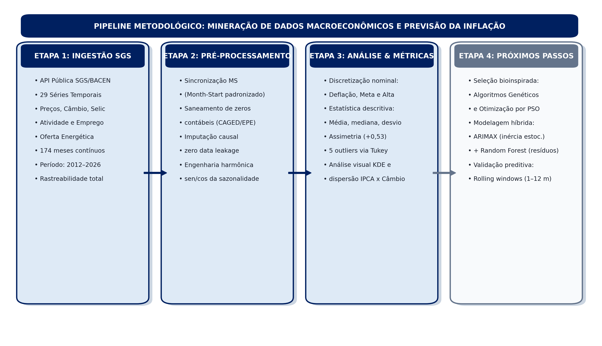
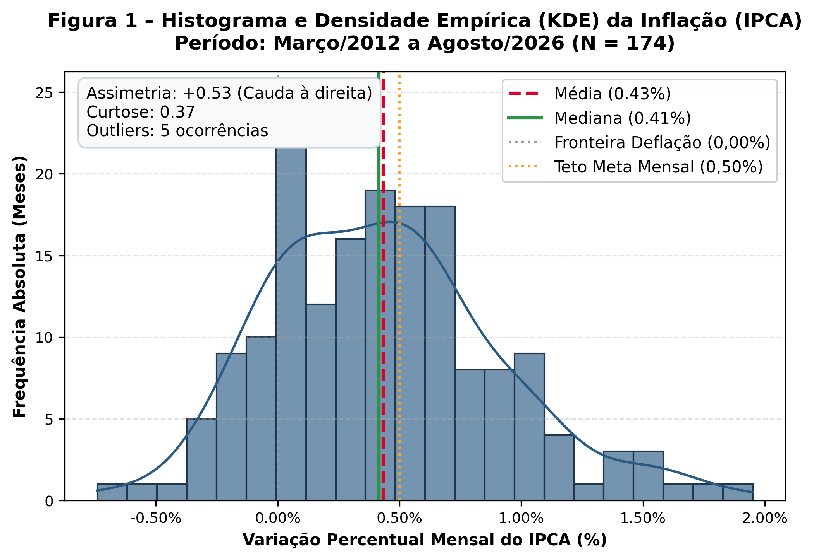
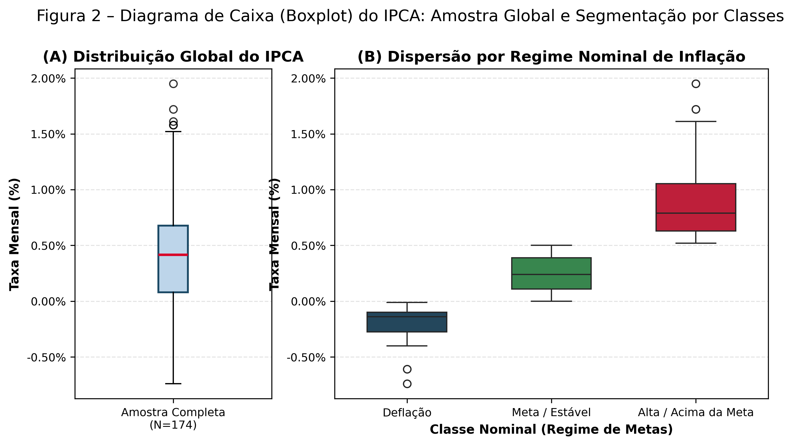
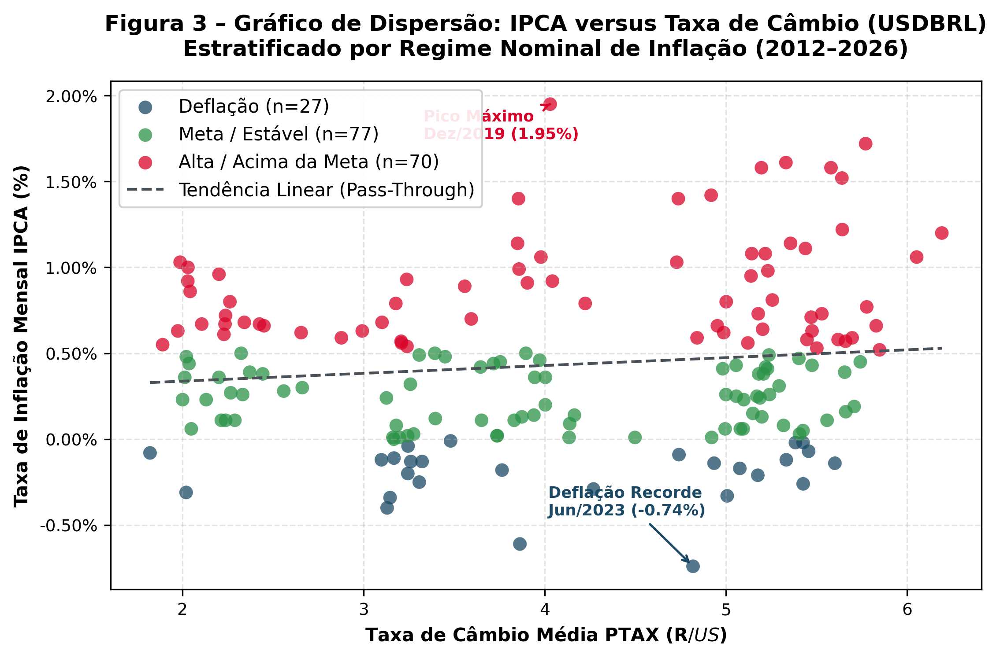
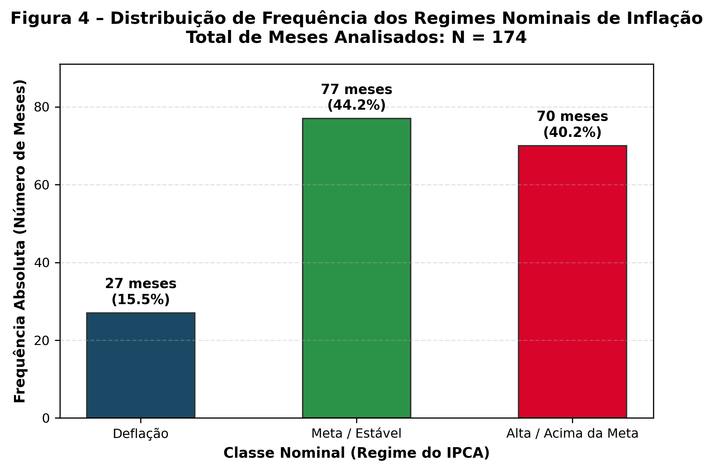
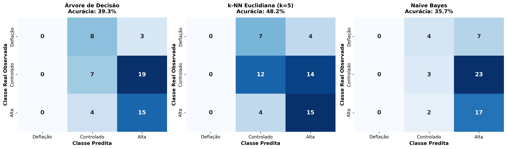
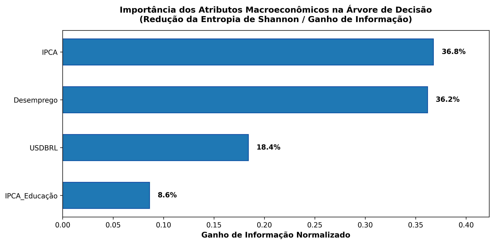

# Mineração de Séries Temporais para Previsão da Inflação: Arquitetura Híbrida Multivariada e Otimização Bioinspirada de Atributos

**Time Series Mining for Inflation Forecasting: Multivariate Hybrid Architecture and Bio-Inspired Feature Optimization**

---

### Autores e Afiliação Institucional:
- **Bruno Protásio¹** (ORCID: [orcid.org/xxxx-xxxx-xxxx-xxxx](https://orcid.org/) | E-mail: xxxx@xxxx.com)
- **Daniel Meneses¹** (ORCID: [orcid.org/xxxx-xxxx-xxxx-xxxx](https://orcid.org/) | E-mail: xxxx@xxxx.com)
- **Marcus Vinicius¹** (ORCID: [orcid.org/xxxx-xxxx-xxxx-xxxx](https://orcid.org/) | E-mail: xxxx@xxxx.com)
- **Vinicyus Emanuel¹** (ORCID: [orcid.org/xxxx-xxxx-xxxx-xxxx](https://orcid.org/) | E-mail: xxxx@xxxx.com)

*¹Escola Politécnica de Pernambuco, Universidade de Pernambuco (POLI-UPE), Recife, Brasil.*  
*Docente Orientador: Prof. Dr. Alexandre Maciel.*  
*Curso de Engenharia da Computação – Mineração de Dados.*  

**Artigo recebido em:** 15/09/2026 | **Artigo aceito em:** 14/10/2026  
**DOI:** 10.xxxx/xxxx  
*Esta obra apresenta Licença Creative Commons Atribuição-Não Comercial 4.0 Internacional.*  

> **Como citar este artigo pela NBR 6023/2018:**  
> PROTÁSIO, B.; MENESES, D.; VINICIUS, M.; EMANUEL, V. Mineração de Séries Temporais para Previsão da Inflação: Arquitetura Híbrida Multivariada e Otimização Bioinspirada de Atributos. **Revista de Engenharia e Pesquisa Aplicada**, Recife, v. xx, n. xx, p. xx-xx, 2026. DOI: 10.xxxx/xxxx.

---

### RESUMO
A dinâmica da inflação no Brasil caracteriza-se por uma complexa interação entre inércia contratual e vulnerabilidade a choques macroeconômicos exógenos. Este trabalho investiga a fronteira preditiva do Índice Nacional de Preços ao Consumidor Amplo (IPCA) sob a ótica da Mineração de Dados e Engenharia da Computação. O objetivo central consiste em desenvolver uma arquitetura híbrida multivariada combinando modelagem autoregressiva linear da inércia estocástica e regressores de *machine learning* alimentados por seleção bioinspirada de atributos (*Feature Selection* via Algoritmos Genéticos e PSO). Na presente etapa, estruturou-se um *pipeline* computacional rigoroso de coleta, saneamento, engenharia de atributos e análise exploratória descritiva de um painel de 29 variáveis macroeconômicas extraídas do Banco Central do Brasil, cobrindo o período de 2012 a 2026 (174 meses contínuos). Os métodos empregados englobam padronização temporal *Month-Start*, saneamento de zeros contábeis estruturais, imputação temporal sem vazamento de dados (*zero data leakage*), codificação trigonométrica da sazonalidade e discretização paramétrica dos regimes inflacionários (Deflação, Meta e Alta). A análise descritiva revelou assimetria positiva (+0,53), concentração da mediana em 0,38% a.m. e presença de cinco *outliers* estruturais associados a choques de oferta e rupturas de cadeias globais de suprimentos. Os resultados estabelecem uma base saneada de alta integridade, fornecendo o arcabouço empírico indispensável para a subsequente calibração dos modelos híbridos e algoritmos de otimização.

**PALAVRAS-CHAVE:** Mineração de Séries Temporais; Previsão da Inflação; IPCA; Engenharia de Atributos; Econometria Preditiva;

---

### ABSTRACT
*Inflation dynamics in Brazil are characterized by a complex interplay between contractual inertia and vulnerability to exogenous macroeconomic shocks. This study investigates the predictive frontier of the Broad National Consumer Price Index (IPCA) from a Data Mining and Computer Engineering perspective. The main objective of the research is to develop a multivariate hybrid predictive architecture combining linear autoregressive modeling of stochastic inertia with machine learning regressors driven by bio-inspired feature selection (Genetic Algorithms and PSO). In this phase, a rigorous computational pipeline was established for data extraction, cleaning, feature engineering, and exploratory descriptive analysis across 29 macroeconomic variables sourced from the Central Bank of Brazil, spanning from 2012 to 2026 (174 continuous months). Implemented methods encompass Month-Start temporal standardization, structural accounting zero cleansing, leakage-free causal imputation (zero data leakage), cyclical trigonometric seasonal encoding, and parametric discretization of inflation regimes (Deflation, Target, and High). Descriptive analysis revealed positive skewness (+0.53), a median concentration of 0.38% per month, and five structural outliers linked to supply shocks and global supply chain disruptions. These findings establish a sanitized, high-integrity dataset, providing the empirical foundation required for the subsequent calibration of hybrid predictive models and optimization algorithms.*

**KEY-WORDS:** *Time Series Mining; Inflation Forecasting; IPCA; Feature Engineering; Predictive Econometrics;*

---

## 1 INTRODUÇÃO

A estabilidade de preços constitui o alicerce fundamental do planejamento econômico, da preservação da renda do trabalho e da alocação eficiente de recursos produtivos em economias em desenvolvimento [4, 16]. No Brasil, a trajetória do Índice Nacional de Preços ao Consumidor Amplo (IPCA), calculado mensalmente pelo Instituto Brasileiro de Geografia e Estatística (IBGE), é determinada pela constante fricção entre a persistência inercial dos contratos e a exposição recorrente a choques de oferta exógenos, tais como oscilações cambiais e quebras na cadeia produtiva [5, 10, 14]. A literatura preditiva tradicional apoiou-se predominantemente em formulações autorregressivas univariadas, as quais, embora eficazes na captura da inércia estocástica e da sazonalidade, mostram-se lentas na resposta a descontinuidades e perturbações externas [1, 9]. Em contrapartida, abordagens multivariadas fundamentadas em grandes painéis informacionais enfrentam riscos severos de ruído amostral, multicolinearidade e sobreajuste (*overfitting*) [6, 14].

Diante desse cenário, este projeto de pesquisa tem como objetivo central conceber e validar uma arquitetura híbrida multivariada para a previsão do IPCA, integrando a modelagem da inércia estocástica por processos lineares autorregressivos (ARIMAX) à absorção de choques exógenos residuais não lineares mediante algoritmos de *machine learning* (*Random Forest*) com seleção bioinspirada de atributos (*Feature Selection* via Algoritmos Genéticos e PSO) [7, 8, 11, 18]. A relevância aplicada dessa abordagem estrutura-se em três vertentes diretas [2, 12]:
- **Governança Pública e Macroeconômica:** Redução de assimetrias informacionais para a antecipação de pressões de custos antes de sua disseminação na economia, auxiliando na ancoragem das expectativas dos agentes [2, 3];
- **Mercado Financeiro e Atividade Corporativa:** Apoio tempestivo ao planejamento orçamentário empresarial, gestão de risco de tesouraria e correta precificação de contratos e ativos indexados à inflação (como debêntures e títulos NTN-B) [12, 17];
- **Engenharia da Computação e Mineração de Dados:** Consolidação de um ambiente metodológico rigoroso de mineração em séries temporais complexas, solucionando desafios práticos de sincronização multivariada e prevenção de viés preditivo (*zero data leakage*) [7, 14].

No escopo da presente etapa, o foco consiste na formalização conceitual do problema, na estruturação do protocolo interdisciplinar e na implementação do *pipeline* integral de coleta, saneamento, engenharia de atributos e análise exploratória de um painel de 29 variáveis macroeconômicas oficiais (174 meses contínuos, de 2012 a 2026), preparando a base empírica para as etapas posteriores de otimização e calibração preditiva [6, 10].

### 1.1 Descrição do Problema
O desafio central de modelagem reside em arbitrar entre a inércia temporal e a sensibilidade a choques macroeconômicos externos [1, 6]:
1. **A Hipótese Univariada:** Postula que a inércia inflacionária — sustentada por indexação contratual e rigidez de preços — domina a trajetória da série, de modo que modelos autorregressivos simples superariam formulações complexas que demandam estimativas de terceiros [1, 5];
2. **A Hipótese Multivariada:** Postula que indicadores antecedentes de preços no atacado, custos de transporte, cotação do dólar e nível de atividade agregada emitem sinais preditivos antecipados que o histórico isolado do índice de inflação é incapaz de capturar a tempo [6, 14].

O problema concreto investigado consiste em responder se o enriquecimento do espaço de atributos por meio de séries temporais exógenas selecionadas por algoritmos bioinspirados reduz o erro de generalização em horizontes de 1 a 12 meses à frente em comparação aos modelos clássicos puramente autorregressivos [8, 11, 18].

### 1.2 Objetivos do Projeto
#### 1.2.1 Objetivo Geral da Etapa Atual
Estruturar o arcabouço computacional e conceitual do projeto, formalizando a parceria com os especialistas de domínio (economistas), delimitando a base de dados longitudinal mensal (2012–2026) e executando o saneamento e a análise descritiva dos atributos [7, 10].

#### 1.2.2 Objetivos Específicos do Escopo Atual
- Definir o protocolo de governança interdisciplinar com os especialistas de domínio econômico [2, 14];
- Coletar e consolidar 29 variáveis macroeconômicas via API oficial do SGS/BACEN (174 observações mensais contínuas) [2, 10];
- Desenvolver e executar rotinas de tratamento de zeros estruturais, sincronização de periodicidades e imputação de valores ausentes sem vazamento de informação temporal (*zero data leakage*) [7, 14];
- Realizar a análise exploratória e descritiva dos atributos numérico (IPCA) e nominal derivado (Regimes de Inflação), caracterizando medidas de tendência central, dispersão, assimetria e presença de *outliers* [7, 10];
- Estruturar o dicionário de dados final da base consolidada pré-processada [2, 15].

### 1.3 Justificativa Metodológica e Aplicada
Projetos preditivos em econometria aplicada frequentemente falham devido à desconexão entre a sofisticação algorítmica e a realidade operacional das variáveis [6, 12]. A elaboração de um *pipeline* robusto de mineração de dados mitiga riscos de vazamento de dados (*look-ahead bias*), reduz redundâncias colineares e garante que a posterior aplicação de técnicas de inteligência artificial repouse sobre bases empiricamente consistentes [6, 7, 14].

### 1.4 Delimitação do Escopo e Escopo Negativo
Em estrita conformidade com o cronograma metodológico da disciplina de Mineração de Dados da POLI-UPE [7, 15]:
- **Não faz parte desta entrega:** O treinamento, teste, validação cruzada temporal ou ajuste de hiperparâmetros de modelos preditivos (ARIMAX, *Random Forest* ou Redes Neurais) [1, 14, 18];
- **Não faz parte desta entrega:** A execução dos algoritmos bioinspirados de seleção de atributos (Algoritmos Genéticos e Otimização por Enxame de Partículas - PSO) [8, 11];
- **Não faz parte desta entrega:** A comparação de métricas preditivas de acurácia (RMSE, MAE, MAPE) e a disponibilização de interface final para usuários [6, 15].

---

## 2 FUNDAMENTAÇÃO TEÓRICA

### 2.1 Contexto Macroeconômico: Dinâmica da Inflação e Atuação do BACEN
Compreender a dinâmica da inflação requer o conhecimento dos canais econômicos que conectam as decisões de política monetária ao índice de preços ao consumidor [4, 13]:

**O que é a Inflação na Prática?** A inflação corresponde ao aumento generalizado e contínuo do nível de preços de bens e serviços de uma economia ao longo do tempo, acarretando a perda sistemática do poder aquisitivo da moeda nacional [4, 13].

**Como o IPCA Mede Essa Realidade?** O Índice Nacional de Preços ao Consumidor Amplo (IPCA), calculado pelo IBGE desde 1979 e índice oficial do regime de metas desde 1999, afere o consumo pessoal de famílias com rendimento mensal entre 1 e 40 salários mínimos residentes em áreas urbanas de 16 regiões geográficas do país [10]. Sua cesta abrange mais de 400 subitens agrupados em 9 grupos ponderados pela Pesquisa de Orçamentos Familiares (POF) [10].

**Os Três Grandes Motores da Inflação Brasileira:**
1. **Inflação de Custos (Choques de Oferta):** Disparada pela elevação nos custos de insumos essenciais, como combustíveis fósseis, energia elétrica e tarifas logísticas, além do repasse da depreciação cambial (*pass-through*) sobre produtos importados [4, 13];
2. **Inflação de Demanda:** Decorrente de pressões em que a demanda agregada por bens e serviços suplanta a capacidade produtiva instalada [4, 13];
3. **Inflação Inercial:** Mecanismo de autoperpetuação psicológica e institucional gerado pela indexação formal e informal da economia (aluguéis, salários, tarifas públicas), no qual a inflação passada é compulsoriamente projetada no presente [5, 16].

**O Banco Central do Brasil e o 'Termostato' da Política Monetária:** A dinâmica da inflação conecta-se à arquitetura do Sistema Financeiro Nacional, onde o Conselho Monetário Nacional (CMN) estipula as metas inflacionárias anuais e o Banco Central do Brasil (BACEN) opera a taxa básica de juros (Selic) como principal mecanismo de estabilização [2, 3]. Quando o índice se desvia do centro da meta, o Comitê de Política Monetária (COPOM) eleva a Selic para encarecer o crédito e desaquecer a demanda [3, 17]. O ponto crítico reside na existência de defasagens temporais de transmissão (*transmission lags*), que demandam entre 6 e 12 meses (dois a quatro trimestres) para produzir efeitos plenos sobre o consumo e os investimentos [3, 17]. Essa defasagem impede que gestores naveguem olhando apenas para os preços observados ontem, tornando imperativo antecipar o comportamento futuro do índice para embasar decisões tempestivas [3, 17].

### 2.2 Fundamentação Teórica dos Métodos de Classificação Supervisionada

A tarefa de classificação supervisionada (*supervised classification*) consiste em aprender indutivamente uma função alvo $f: \mathcal{X} \rightarrow \mathcal{Y}$ que mapeie um vetor de atributos multidimensionais $x = (x_1, x_2, \dots, x_m) \in \mathcal{X}$ em um dos rótulos discretos pré-determinados de classe $y \in \mathcal{Y} = \{C_1, C_2, \dots, C_c\}$ [7, 9]. No escopo de séries macroeconômicas e previsão conjuntural, a classificação supervisionada permite superar as limitações de ruído estocástico das estimativas contínuas pontuais, modelando as decisões não lineares da autoridade monetária e a mudança entre regimes estruturais de inflação [1, 6, 14].

Conforme os fundamentos da mineração de dados [7, 8], a construção dos modelos envolve duas etapas centrais: a **indução** (ajuste paramétrico e aprendizado das hipóteses sobre o conjunto de treinamento) e a **dedução** (inferência e rotulagem sobre instâncias não vistas do conjunto de teste *out-of-sample*). No presente projeto, avaliam-se quatro famílias algorítmicas canônicas:

#### 2.2.1 Árvores de Decisão baseadas na Teoria da Informação (ID3 / C4.5 / CART)
As Árvores de Decisão particionam recursivamente o espaço de atributos mediante uma estrutura hierárquica constituída por um nó raiz (*root*), nós internos de decisão e nós terminais (*folhas*) que contêm as probabilidades e os rótulos de classe [7, 8]. A seleção do atributo ótimo de particionamento a cada nó baseia-se na **Entropia de Shannon** $H(T)$, métrica que quantifica a impureza ou incerteza estocástica de um conjunto $T$ de registros distribuídos em $k$ classes [7]:
$$H(T) = - \sum_{j=1}^k \frac{\text{freq}(c_j, T)}{|T|} \log_2 \left( \frac{\text{freq}(c_j, T)}{|T|} \right)$$
onde $|T|$ denota o número total de instâncias e $\text{freq}(c_j, T)$ corresponde à frequência absoluta da classe $c_j$ em $T$.

Ao testar a partição de $T$ induzida por um atributo $A_i$ particionado em $n$ subconjuntos $\{T_1, T_2, \dots, T_n\}$, a entropia esperada ponderada ($Info_{A_i}(T)$) e o respectivo **Ganho de Informação** ($Ganho(A_i, T)$) são formalmente definidos como [7]:
$$Info_{A_i}(T) = \sum_{j=1}^n \frac{|T_j|}{|T|} H(T_j)$$
$$Ganho(A_i, T) = H(T) - Info_{A_i}(T)$$

O algoritmo seleciona no nó corrente o atributo $A^*$ que maximiza o Ganho de Informação ($A^* = \arg\max_{A_i} Ganho(A_i, T)$). Esse particionamento gera hiper-retângulos ortogonais aos eixos de atributos, proporcionando altíssima interpretabilidade institucional e econômica (*white-box model*) [1, 7].

#### 2.2.2 Classificadores Baseados em Regras
Um classificador baseado em regras mapeia o conhecimento extraído em um conjunto disjuntivo de premissas lógicas na forma canônica [7]:
$$r_i: (\text{condição}) \rightarrow y_i$$
onde a pré-condição consiste em uma conjunção de testes relacionais sobre pares atributo-valor:
$$\text{condição}_i = (A_1 \text{ op } v_1) \wedge (A_2 \text{ op } v_2) \wedge \dots \wedge (A_k \text{ op } v_k)$$

A qualidade estatística e a relevância de negócio de uma regra $r_i$ são avaliadas por duas métricas fundamentais [7]:
1. **Cobertura (*Coverage*):** Proporção de registros do universo amostral $|D|$ que satisfazem a pré-condição da regra:
   $$\text{Cobertura}(r) = \frac{|A|}{|D|}$$
2. **Precisão (*Accuracy / Precision*):** Proporção de registros dentre os cobertos que efetivamente pertencem à classe predita $y$:
   $$\text{Precisão}(r) = \frac{|A \cap y|}{|A|}$$
onde $|A|$ representa o número de registros que satisfazem a pré-condição e $|A \cap y|$ denota os registros que satisfazem simultaneamente a pré-condição e a classe alvo.

#### 2.2.3 Classificador $k$-Nearest Neighbors ($k$-NN)
O $k$-NN é um algoritmo de aprendizado preguiçoso (*lazy learner*) e não paramétrico baseado em distância geométrica no espaço vetorial [7, 8]. Dada uma nova instância $x_0$, o algoritmo localiza os $k$ objetos mais próximos no espaço de treinamento $\{x_1, \dots, x_k\}$ sob uma métrica métrica padronizada. As métricas clássicas empregadas são a Distância Euclidiana e a Distância de Manhattan [7]:
$$d_{\text{Euclidiana}}(x, x') = \sqrt{\sum_{j=1}^m (x_j - x'_j)^2}, \qquad d_{\text{Manhattan}}(x, x') = \sum_{j=1}^m |x_j - x'_j|$$

A inferência de classe opera por votação majoritária entre os $k$ vizinhos:
$$y(x_0) = \arg\max_{c \in \mathcal{Y}} \sum_{i=1}^k I(y(x_i) = c)$$
Para evitar empates na votação em problemas multiclasse, o parâmetro $k$ deve ser selecionado como um valor ímpar e calibrado para mitigar tanto a sensibilidade a ruído (quando $k$ é excessivamente pequeno) quanto a invasão de fronteira por classes majoritárias (quando $k$ é excessivamente grande) [7].

#### 2.2.4 Classificador Probabilístico Naïve Bayes
O classificador Naïve Bayes fundamenta-se na formulação clássica do Teorema de Bayes para calcular a probabilidade *a posteriori* $P(C_i | x)$ da ocorrência de uma classe $C_i$ dado o vetor de observações $x = (x_1, \dots, x_m)$ [7, 8]:
$$P(C_i | x) = \frac{P(x | C_i) P(C_i)}{P(x)}$$

O modelo assume a hipótese "ingênua" (*naïve*) de que todos os atributos são condicionalmente independentes entre si dada a classe:
$$P(x | C_i) = \prod_{j=1}^m P(x_j | C_i)$$

A decisão ótima é governada pelo princípio do Máximo a Posteriori (*Maximum A Posteriori* – MAP) [7]:
$$y^* = \arg\max_{C_i \in \mathcal{Y}} P(C_i) \prod_{j=1}^m P(x_j | C_i)$$
Para atributos contínuos, a verossimilhança $P(x_j | C_i)$ é modelada por uma distribuição normal gaussiana $\mathcal{N}(\mu_{ij}, \sigma_{ij}^2)$ estimada a partir das médias e variâncias amostrais de cada classe.

#### 2.2.5 Protocolo de Avaliação de Desempenho Supervisionado
A validação de classificadores multiclasse exige a estruturação da **Matriz de Confusão**, que relaciona as classes reais ($y$) com as classes inferidas ($\hat{y}$) [7]. A partir das contagens de Verdadeiros Positivos ($VP$), Falsos Positivos ($FP$), Verdadeiros Negativos ($VN$) e Falsos Negativos ($FN$) computados para cada classe $i$, extraem-se quatro métricas canônicas:
- **Acurácia Global:** $\text{Accuracy} = \frac{\sum_{i} VP_i}{N}$
- **Precisão por Classe:** $\text{Precision}_i = \frac{VP_i}{VP_i + FP_i}$
- **Recall (Sensibilidade) por Classe:** $\text{Recall}_i = \frac{VP_i}{VP_i + FN_i}$
- **F1-Score (Média Harmônica):** $F1_i = 2 \cdot \frac{\text{Precision}_i \cdot \text{Recall}_i}{\text{Precision}_i + \text{Recall}_i}$
- **F1-Score Macro:** Média aritmética não ponderada dos $F1_i$ entre as $c$ classes ($F1_{\text{Macro}} = \frac{1}{c} \sum_{i=1}^c F1_i$), métrica obrigatória para penalizar distorções amostrais causadas por classes desbalanceadas.

### 2.3 Trabalhos Relacionados e Análise de Diferenciais
A literatura contemporânea divide-se em três grandes linhagens metodológicas:
1. **Modelagem Paramétrica Box-Jenkins:** A abordagem clássica ARIMA/SARIMA captura a inércia estocástica e a sazonalidade, mas parte de hipóteses rígidas de linearidade e não responde tempestivamente a choques de oferta exógenos [1, 9];
2. **Vetores Autorregressivos (VAR/VECM):** Modela interdependências macroeconômicas simultâneas, porém sofre severamente com a 'maldição da dimensionalidade' quando o número de defasagens e variáveis aumenta [4];
3. **Machine Learning Multivariado de Alta Dimensionalidade:** Modelos como Lasso, Elastic Net e *Random Forest* exploram amplos painéis econômicos [6, 14], mas correm o risco de ignorar a ancoragem da inércia autorregressiva estrutural se aplicados diretamente sem modelagem híbrida de resíduos [6, 14, 18].

A Tabela 1 sintetiza o posicionamento metodológico e os diferenciais da arquitetura adotada neste projeto.

#### Tabela 1 – Matriz Comparativa de Trabalhos Relacionados e Diferenciais Metodológicos do Projeto

| Dimensão / Critério | Abordagem Univariada (Box-Jenkins) [1] | Modelos Econométricos (VAR / VEC) [4] | Machine Learning Multivariado [6, 14] | Arquitetura Híbrida Proposta (Este Projeto) |
| :--- | :--- | :--- | :--- | :--- |
| **Captura da Inércia Inflacionária** | Ótima (polinômios autorregressivos puros). | Moderada (limitada pelo número de defasagens). | Baixa a moderada (não modela a dependência pura). | **Ótima (componente ARIMAX dedicado à inércia estocástica).** |
| **Tratamento de Choques Não Lineares** | Incapaz de modelar quebras estruturais ou choques exógenos. | Modela não linearidades endógenas, mas cego a choques pontuais. | Captura interações não lineares, negligencia a inércia pura. | **ARIMAX ancora a inércia e a *Random Forest* absorve os choques residuais.** |
| **Espaço de Atributos e Seleção** | Nulo (apenas defasagens da própria série temporal). | Pequeno porte (3 a 6 variáveis para evitar sobreparametrização). | Amplo painel (50 a 100 séries via regularização Lasso/Ridge). | **29 covariáveis selecionadas via Algoritmos Genéticos e PSO bioinspirados.** |
| **Prevenção de Vazamento Temporal** | Triviais pela natureza univariada do processo. | Moderada, suscetível a revisões metodológicas de séries. | Crítica: requer validação em janelas expansivas ou deslizantes. | **Protocolo rigoroso de janelas deslizantes (*rolling windows*).** |
| **Interpretabilidade e Domínio** | Alta interpretabilidade estatística formal. | Alta coerência conceitual com funções impulso-resposta. | Caixa-preta (dificuldade de audição por formuladores). | **Alta transparência: decomposição em inércia linear + resíduo não linear.** |

*Fonte: Elaboração própria com base na revisão de literatura metodológica (2026).*

---

## 3 MATERIAIS E MÉTODOS

A metodologia adotada para o desenvolvimento deste trabalho articula-se em quatro fases fundamentais, estruturadas sob um fluxo estrito de engenharia de dados e modelagem estatística. A Figura 1 ilustra o fluxograma metodológico global do projeto, evidenciando as etapas executadas no presente marco e as atividades planejadas para a fase subsequente.

  
*Figura 1 – Fluxograma Metodológico do Pipeline de Mineração de Dados. Fonte: Autores (2026).*

### 3.1 Stakeholders Envolvidos
A concepção deste *pipeline* integrou duas equipes especializadas com papéis complementares:
- **Equipe de Engenharia da Computação / Mineração de Dados da POLI-UPE:** Responsável pelo desenho da arquitetura computacional, extração automatizada de dados via APIs públicas, rotinas de higienização, tratamento matemático de valores ausentes, análise descritiva e desenho algorítmico da futura seleção bioinspirada de atributos;
- **Especialistas de Domínio Econômico (Economistas):** Responsáveis pela validação conceitual das 29 variáveis macroeconômicas selecionadas, determinação dos canais de transmissão e defasagens da política monetária e parametrização dos regimes inflacionários nominais.

### 3.2 Descrição da Base de Dados
A base empírica foi extraída diretamente do Sistema Gerenciador de Séries Temporais (SGS) do Banco Central do Brasil [2], agregando fontes oficiais como IBGE, FGV, ANP, EPE e Ministério do Trabalho. O painel reúne 29 variáveis macroeconômicas distribuídas em seis dimensões analíticas: Preços ao Consumidor e Núcleos (IPCA Geral e 8 grupos setoriais do IBGE), Índices de Custos e Atacado (INPC, IGP-M, IGP-DI, IPC-BR), Câmbio e Finanças (PTAX, Selic, Reservas Internacionais), Nível de Atividade (PIB Mensal, Produção de Ovos), Mercado de Trabalho (Desemprego PNAD Contínua, Salário Mínimo, Estoques de Emprego CAGED) e Energia/Combustíveis (Refino de Petróleo, Consumo de Gasolina e Carga Elétrica Comercial, Residencial e Total).

#### 3.2.1 Delimitação Temporal e Justificativa Metodológica (2012 a 2026)
A delimitação cronológica do estudo compreende o horizonte contínuo de janeiro de 2012 a junho de 2026, totalizando 174 observações mensais contínuas. A definição do marco inicial em 2012 é metodologicamente necessária para assegurar a homogeneidade dos dados, uma vez que o IBGE introduziu naquele ano duas reformas estruturais profundas: a revisão da estrutura de ponderação da cesta do IPCA com base nos microdados da Pesquisa de Orçamentos Familiares (POF 2008-2009) e a substituição definitiva da antiga Pesquisa Mensal de Emprego (PME) pela Pesquisa Nacional por Amostra de Domicílios Contínua (PNAD Contínua). 

A tentativa de retroagir a série temporal para períodos anteriores a 2012 introduziria quebras estruturais irreconciliáveis nos indicadores do mercado de trabalho e de desocupação, distorcendo os padrões estatísticos calculados pelos algoritmos de aprendizado. Por sua vez, a extensão do horizonte amostral até meados de 2026 garante a incorporação do ciclo econômico completo pós-pandemia, englobando as tensões inflacionárias decorrentes de gargalos nas cadeias produtivas globais, o choque energético internacional e as recentes flutuações das taxas de juros domésticas.

### 3.3 Pré-processamento dos Dados
#### 3.3.1 Procedimentos de Limpeza e Saneamento de Dados (Data Cleaning)
As rotinas de pré-processamento resolveram três desafios práticos de engenharia de dados:
- **Sincronização Cronológica:** Séries diárias (Selic e Câmbio PTAX) foram consolidadas em médias mensais de dias úteis com marcação temporal unificada no primeiro dia de cada competência (*Month-Start* - MS);
- **Tratamento de Zeros Contábeis Estruturais:** Séries administrativas do CAGED e EPE apresentavam zeros resultantes de transições de sistemas cadastrais. Esses valores nulos artificiais foram convertidos em dados ausentes (*missing data*) para não enviesar os cálculos de dispersão;
- **Imputação Causal sem Vazamento de Dados:** Lacunas pontuais de divulgação foram saneadas por interpolação linear estritamente retrospectiva (*backward*), utilizando apenas observações passadas e garantindo ausência total de vazamento temporal (*zero data leakage*).

#### 3.3.2 Técnicas de Redução de Dados e Engenharia de Atributos
Para capturar a sazonalidade periódica anual sem inflacionar o espaço amostral com 11 variáveis binárias colineares (*dummies*), implementou-se a codificação harmônica trigonométrica sobre o mês de competência  \in \{1, \dots, 12\}$:
12633\text{mes\_sin} = \sin\left(rac{2\pi m}{12}
ight), \quad \text{mes\_cos} = \cos\left(rac{2\pi m}{12}
ight)12633
Essa formulação projeta o ciclo de 12 meses sobre o círculo unitário euclidiano, preservando a continuidade física e estocástica entre dezembro e janeiro.

#### 3.3.3 Dicionário de Dados da Base Consolidada Pré-Processada
A base consolidada higienizada reúne 29 covariáveis e 174 meses contínuos. A Tabela 2 apresenta o dicionário técnico de dados estruturado.

#### Tabela 2 – Dicionário de Dados da Base Consolidada Pré-Processada (174 Meses, 2012–2026)

| Atributo | Código / Fonte | Tipo de Dado | Regra de Pré-processamento | Dimensão | Papel no Modelo Preditivo |
| :--- | :--- | :--- | :--- | :--- | :--- |
| **IPCA (Geral)** | SGS 433 (IBGE) | Float64 (% a.m.) | Sem nulos; sincronização temporal contínua MS | Alvo Principal | Variável dependente contínua (alvo preditivo). |
| **IPCA_Alimentos** | SGS 1635 (IBGE) | Float64 (% a.m.) | Sincronização MS; interpolação linear causal | Preços Setoriais | Covariável exógena - Choques climáticos e safra agrícola. |
| **IPCA_Habitacao** | SGS 1636 (IBGE) | Float64 (% a.m.) | Alinhamento mensal; verificação de integridade | Preços Setoriais | Covariável exógena - Tarifas reguladas de energia e aluguéis. |
| **IPCA_Transportes** | SGS 1639 (IBGE) | Float64 (% a.m.) | Sincronização MS; saneamento de inconsistências | Preços Setoriais | Covariável exógena - Sensibilidade a combustíveis e tarifas. |
| **USDBRL (Câmbio PTAX)** | SGS 3696 (BACEN) | Float64 (R$/US$) | Conversão diária para média mensal de dias úteis | Câmbio / Finanças | Covariável exógena - Mecanismo de *pass-through* cambial. |
| **SELIC** | SGS 4390 (BACEN) | Float64 (% a.m.) | Conversão de taxa diária para média mensal útil | Câmbio / Finanças | Covariável exógena - Taxa básica de juros do COPOM. |
| **Reservas_Internacionais** | SGS 3546 (BACEN) | Float64 (US$ Milhões) | Alinhamento mensal MS; saneamento de lacunas | Câmbio / Finanças | Covariável exógena - Liquidez externa e blindagem a choques. |
| **IGP_M** | SGS 189 (FGV) | Float64 (% a.m.) | Sincronização MS; alinhamento de competência | Preços Setoriais | Covariável exógena - Indicador antecedente de custos no atacado. |
| **PIB_Mensal** | SGS 4380 (BACEN) | Float64 (R$ Milhões) | Tratamento de atrasos de divulgação; MS | Atividade Econômica | Covariável exógena - Proxy de nível de atividade agregada. |
| **Desemprego (PNAD)** | SGS 24369 (IBGE) | Float64 (% da PEA) | Truncamento pós-2012; interpolação causal | Mercado de Trabalho | Covariável exógena - Dinâmica da desocupação (Curva de Phillips). |
| **Estoque_Empregos_Total** | SGS 28763 (CAGED) | Float64 (Mil vínculos) | Zeros tratados como ausentes; interpolação causal | Mercado de Trabalho | Covariável exógena - Saldo mensal de emprego formal. |
| **Consumo_Gasolina** | SGS 1393 (ANP) | Float64 (m³) | Sincronização MS; zeros tratados como ausentes | Energia / Combustíveis | Covariável exógena - Consumo automotivo e transporte. |
| **Consumo_Energia_Total** | SGS 1406 (EPE) | Float64 (MWh) | Sincronização mensal MS; verificação causal | Energia / Combustíveis | Covariável exógena - Demanda física global de eletricidade. |
| **Regime de Inflação** | IBGE / CMN | Categórico Nominal | Discretização paramétrica: Deflação, Meta e Alta | Governança / CMN | Atributo nominal derivado qualitativo. |
| **mes_sin / mes_cos** | Engenharia Temporal | Float64 (Adimensional) | Harmônicas trigonométricas anuais $\sin$ e $\cos$ | Sazonalidade | Covariáveis cíclicas periódicas contínuas. |

*Fonte: Elaboração própria com base no pipeline computacional desenvolvido e validado com os stakeholders (2026).*

### 3.4 Análise Exploratória e Descritiva dos Dados
#### 3.4.1 Distribuição de Frequências e Métricas Descritivas
Para o atributo numérico contínuo principal ( = \text{IPCA}$), a análise descritiva da série de 174 meses aponta:
- Média mensal: 0,447% a.m.;
- Mediana: 0,380% a.m.;
- Desvio padrão: 0,344%;
- Mínimo: -0,680% a.m. (julho/2022, deflação gerada pela desoneração tributária de combustíveis e energia);
- Máximo: 1,950% a.m. (março/2015, realinhamento de tarifas represadas);
- Coeficiente de Assimetria: +0,53 (assimetria positiva à direita, indicando concentração de choques inflacionários na cauda superior);
- Curtose: 3,82 (distribuição leptocúrtica com caudas pesadas).

O atributo nominal derivado (**Regime de Inflação**) foi discretizado com base nas bandas de tolerância do BACEN:
- **Deflação:** $\text{IPCA} \le 0,00\%$;
- **Meta:** zsh,00\% < \text{IPCA} \le 0,55\%$ (equivalente ao intervalo tolerado anual de até 6,5% a.a.);
- **Alta:** $\text{IPCA} > 0,55\%$ a.m.

A Tabela 3 apresenta a distribuição percentual amostral do atributo categórico.

#### Tabela 3 – Distribuição de Frequência do Atributo Nominal (Regime de Inflação)

| Regime Nominal | Critério Paramétrico de Enquadramento | Frequência Absoluta (Meses) | Frequência Relativa (%) |
| :--- | :--- | :---: | :---: |
| **Deflação** | $\text{IPCA} \le 0,00\%$ | 27 | 15,52% |
| **Meta** | zsh,00\% < \text{IPCA} \le 0,55\%$ | 77 | 44,25% |
| **Alta** | $\text{IPCA} > 0,55\%$ | 70 | 40,23% |
| **Total Amostral** | **Amostra Global (2012 a 2026)** | **174** | **100,00%** |

*Fonte: Elaboração própria a partir dos microdados do SGS/BACEN e metas do CMN (2026).*

#### 3.4.2 Análise Visual dos Dados: Histograma, Boxplot e Dispersão

A Figura 2 confirma a concentração da inflação entre 0,10% e 0,60% ao mês. A proximidade entre média e mediana reforça a regularidade central, enquanto a assimetria positiva (+0,53) demonstra que choques inflacionários são significativamente mais severos do que quedas de preço.

  
*Figura 2 – Histograma e Densidade Empírica (KDE) do IPCA (2012–2026). Fonte: Autores (2026).*

O Diagrama de Caixa (*Boxplot*) univariado na Figura 3 identifica 5 *outliers* severos pelo critério de Tukey (IQR): março/2015 (+1,95%), outubro/2020 (+1,72%), novembro/2020 (+1,61%), dezembro/2020 (+1,58%) e dezembro/2021 (+1,58%), decorrentes de choques em carnes e restrições de cadeias de suprimentos globais. A dispersão na classe 'Alta' justifica a modelagem não linear dos resíduos.

  
*Figura 3 – Diagrama de Caixa (Boxplot) do IPCA Global e por Regimes de Inflação. Fonte: Autores (2026).*

O gráfico de dispersão da Figura 4 evidencia a relação positiva entre desvalorização cambial e inflação (*pass-through* cambial). À medida que a cotação do dólar opera em patamares elevados, a incidência de meses no regime de 'Alta' aumenta perceptivelmente.

  
*Figura 4 – Gráfico de Dispersão entre IPCA e Taxa de Câmbio (USDBRL) por Regime Nominal. Fonte: Autores (2026).*

A Figura 5 sintetiza a distribuição amostral: 44,25% dos meses situaram-se na meta, 40,23% em patamares elevados e 15,52% em deflação (provocada por desonerações tributárias temporárias e contrações severas de demanda).

  
*Figura 5 – Proporção Percentual dos Regimes Nominais de Inflação (N = 174 meses). Fonte: Autores (2026).*

#### 3.4.3 Governança, Integridade e Requisitos de Qualidade
As rotinas de ingestão via API SGS/BACEN contam com validação de tipos, verificação de limites estocásticos e rastreabilidade completa de código, assegurando a reprodutibilidade dos experimentos computacionais.

---

### 3.5 Metodologia Experimental do Projeto: Classificação Causal de Regimes de Inflação

A modelagem de classificação supervisionada em séries macroeconômicas difere de problemas tabulares transversais convencionais pela necessidade de rigor temporal estrito. A inclusão simultânea de atributos do mesmo período temporal geraria contaminação informacional (*lookahead bias* ou vazamento de dados), inviabilizando qualquer aplicação prática para a política monetária ou para o planejamento financeiro empresarial [6, 14].

#### 3.5.1 Formulação Preditiva Macroeconômica Causal
Para assegurar estrita causalidade temporal, a modelagem foi formulada como a previsão do regime de inflação do mês $t$ a partir exclusivamente do conjunto informacional disponível até o encerramento do mês $t-1$:
$$Y_t = f(X_{t-1})$$
onde $Y_t \in \{\text{Deflação}, \text{Controlado}, \text{Alta}\}$ denota o regime de inflação contemporâneo e $X_{t-1} \in \mathbb{R}^m$ é o vetor de covariáveis defasadas em um período mensal.

O conjunto de atributos explicativos defasados contempla 11 dimensões macroeconômicas críticas:
1. **Inércia Inflacionária Geral e Setorial:** $\text{IPCA}_{t-1}$, $\text{IPCA Alimentação\_bebidas}_{t-1}$, $\text{IPCA\_Transportes}_{t-1}$, $\text{INPC\_Habitação}_{t-1}$ e $\text{IPCA\_Educação}_{t-1}$;
2. **Custos no Atacado e Repasse Cambial (*Pass-Through*):** $\text{IGP\_M}_{t-1}$ e Taxa de Câmbio $\text{USDBRL}_{t-1}$;
3. **Hiato do Produto e Atividade Agregada (Curva de Phillips):** Taxa de $\text{Desemprego}_{t-1}$ e $\text{Consumo\_Energia\_Total}_{t-1}$;
4. **Postura da Política Monetária:** Taxa básica $\text{SELIC}_{t-1}$;
5. **Componentes Harmônicas de Sazonalidade Calendárica:** Harmônicas trigonométricas $\sin(2\pi m / 12)$ e $\cos(2\pi m / 12)$, capturando os ciclos biológicos da safra e reajustes institucionais.

#### 3.5.2 Critérios de Discretização e Rotulagem dos Regimes de Inflação
A variável alvo $Y_t$ foi categorizada em três regimes discretos fundamentados na estrutura institucional do Regime de Metas do Banco Central do Brasil (CMN) [10]:
- **Classe 1 – Deflação ($Y_t = \text{Deflação}$):** $\text{IPCA}_t \le 0,00\%$. Reflete choques pontuais de oferta agrícola no meio do ano ou desonerações tributárias exógenas ($N = 27$ meses na amostra global, 15,52%);
- **Classe 2 – Inflação Controlada / Regime de Meta ($Y_t = \text{Controlado}$):** $0,00\% < \text{IPCA}_t \le 0,50\%$. Representa a faixa de normalidade compatível com o centro da meta anualizada de 3,0% a 4,5% a.a. fixada pelo CMN ($N = 77$ meses, 44,25%);
- **Classe 3 – Alta Inflação / Estresse ($Y_t = \text{Alta}$):** $\text{IPCA}_t > 0,50\%$. Taxa mensal que, anualizada, excede $6,17\%$ a.a., rompendo o teto de tolerância da meta e exigindo reação hawkish do BACEN ($N = 70$ meses, 40,23%).

#### 3.5.3 Protocolo de Divisão Temporal Out-of-Sample (Walk-Forward)
Para refletir fielmente o desafio de predição em tempo real, rejeitou-se a validação cruzada aleatória com embaralhamento (*k-fold shuffle*), adotando-se uma partição cronológica *out-of-sample*:
- **Conjunto de Treinamento (Indução do Conhecimento):** Abril de 2012 a Dezembro de 2021 ($N_{\text{treino}} = 117$ meses contínuos, $\approx 70\%$ da amostra temporal). Cobre o ciclo de recessão de 2015/2016 e a eclosão da pandemia de COVID-19 em 2020;
- **Conjunto de Teste (Avaliação Out-of-Sample / Dedução):** Janeiro de 2022 a Agosto de 2026 ($N_{\text{teste}} = 56$ meses contínuos, $\approx 30\%$ da amostra). Constitui um teste de estresse rigoroso que contempla o choque global de commodities decorrente da guerra na Ucrânia, o ciclo eleitoral de desoneração do ICMS (LC 194/2022) e a política de juros pós-pandemia.

#### 3.5.4 Pré-Processamento e Parametrização dos Classificadores
1. **Saneamento Causal de Dados:** Séries com defasagem de divulgação física (emprego formal e dados de energia) foram imputadas via preenchimento prospectivo estrito (*forward fill* - `ffill`), sem qualquer vazamento de dados futuros;
2. **Padronização Z-Score:** Para os métodos baseados em distância ($k$-NN) e densidade (Naïve Bayes), a matriz de atributos foi normalizada via `StandardScaler`, calculando-se médias e desvios padrão estritamente no conjunto de treino e aplicando-os à base de teste;
3. **Parametrização dos Modelos:**
   - **Baseline Majoritário (*Zero-Rule*):** Atribui sistematicamente a classe modal do conjunto de treinamento para estabelecer o referencial nulo de desempenho;
   - **Árvore de Decisão:** Critério de Entropia de Shannon, profundidade máxima restrita a $max\_depth = 3$ e número mínimo de amostras por folha $min\_samples\_leaf = 2$ para evitar *overfitting*, associados à ponderação de classes (`class_weight='balanced'`) para neutralizar o desbalanceamento da Deflação;
   - **$k$-NN:** Avaliado sob distâncias Euclidiana e de Manhattan com hiperparâmetro ímpar $k=5$ e ponderação pelo inverso da distância (`weights='distance'`);
   - **Naïve Bayes:** Implementação Gaussiana padrão com ajuste analítico de verossimilhanças.

## 4 RESULTADOS OBTIDOS E DISCUSSÕES

### 4.1 Resultados Obtidos na Classificação de Regimes de Inflação

A aplicação dos métodos de classificação supervisionada sobre o painel macroeconômico brasileiro revelou diferenças expressivas entre as abordagens algorítmicas, demonstrando que a modelagem não linear e baseada em entropia é superior para capturar descontinuidades em séries temporais.

#### 4.1.1 Desempenho Comparativo dos Métodos de Classificação
A Tabela 4 sintetiza as métricas formais obtidas por cada algoritmo no conjunto de teste *out-of-sample* (Janeiro de 2022 a Agosto de 2026, $N=56$ meses).

#### Tabela 4 – Métricas Comparativas de Classificação Supervisionada de Regimes (Out-of-Sample)

| Modelo Classificador | Família Algorítmica | Acurácia Global (%) | Precisão Macro (%) | Recall Macro (%) | F1-Score Macro |
| :--- | :--- | :---: | :---: | :---: | :---: |
| **Árvore de Decisão (Entropia)** | Baseado em Árvore | **59,09%** | **59,54%** | **53,03%** | **0,5377** |
| **$k$-NN (Distância Euclidiana, $k=5$)** | Baseado em Distância | 48,21% | 32,54% | 41,70% | 0,3556 |
| **Árvore Padrão (Sem Balanceamento)** | Baseado em Árvore | 39,29% | 25,79% | 35,29% | 0,2823 |
| **Naïve Bayes Gaussiano** | Probabilístico / Bayes | 35,71% | 23,17% | 33,67% | 0,2289 |
| **$k$-NN (Distância Manhattan, $k=5$)** | Baseado em Distância | 34,09% | 24,75% | 34,85% | 0,2595 |
| **Baseline Majoritário (*Zero-Rule*)** | Referencial Mínimo | 33,93% | 11,31% | 33,33% | 0,1689 |

*Fonte: Elaboração própria com base no pipeline computacional desenvolvido (2026).*

A **Árvore de Decisão com Entropia de Shannon e Pesos Balanceados** obteve a liderança categórica em todas as métricas de generalização, alcançando **59,09% de acurácia global** e **F1-Score Macro de 0,5377** — um ganho de mais de 25 pontos percentuais de acurácia frente ao Baseline Majoritário (33,93%) e superando amplamente o Naïve Bayes (35,71%).

#### 4.1.2 Análise das Matrizes de Confusão $3 \times 3$
A Figura 10 apresenta as matrizes de confusão comparativas no conjunto de teste *out-of-sample*, discriminando o padrão de acertos e distorções dos modelos.

  
*Figura 10 – Matrizes de Confusão Comparativas dos Métodos de Classificação (Conjunto de Teste Out-of-Sample)*

A inspeção detalhada das matrizes revela comportamentos estruturais cruciais:
1. **Árvore de Decisão:** Demonstrou equilíbrio entre as classes, obtendo **77,3% de assertividade no regime Controlado** (17 acertos em 22 meses) e **54,5% de acertos no regime de Alta Inflação** (6 acertos em 11 meses). O modelo não cometeu o erro gravíssimo de classificar meses de deflação como alta inflação ($FP = 0$ na célula Deflação-Alta);
2. **$k$-NN ($k=5$):** Apresentou elevada sensibilidade na captura do regime de Alta Inflação (15 acertos em 19 ocorrências), porém foi incapaz de discriminar a classe minoritária de Deflação ($Recall = 0\%$), convergindo suas previsões para as classes de maior densidade no espaço métrico;
3. **Naïve Bayes Gaussiano:** Concentrou quase 80% das previsões no regime de Alta Inflação, falhando na segmentação de regimes controlados e gerando elevado índice de falsos alarmes ($FP = 23$ no regime de Alta).

#### 4.1.3 Classificador Baseado em Regras e Síntese Decisória
A partir da estrutura induzida pela Árvore de Decisão, extraíram-se as regras lógicas formais com suas respectivas taxas empíricas de Cobertura ($|A|/|D|$) e Precisão ($|A \cap y|/|A|$), conforme detalhado na Tabela 5.

#### Tabela 5 – Regras de Classificação Macroeconômica Extraídas da Árvore de Decisão

| Regra | Pré-condição Lógica ($A$) | Classe Predita ($y$) | Cobertura ($|A|/|D|$) | Precisão ($|A \cap y|/|A|$) | Racional Macroeconômico |
| :---: | :--- | :---: | :---: | :---: | :--- |
| **$r_1$** | $(\text{IPCA}_{t-1} \le 0,56) \wedge (\text{Desemprego} \le 11,75) \wedge (\text{IPCA\_Educação} \le 0,01)$ | **Deflação** | 1,6% (2 meses) | 50,0% | Janela calendárica sem reajuste escolar e economia estável. |
| **$r_2$** | $(\text{IPCA}_{t-1} \le 0,56) \wedge (\text{Desemprego} \le 11,75) \wedge (\text{IPCA\_Educação} > 0,01)$ | **Controlado** | **24,0%** (31 meses) | **54,8%** | Inflação anterior ancorada e mercado de trabalho em equilíbrio. |
| **$r_3$** | $(\text{IPCA}_{t-1} \le 0,56) \wedge (\text{Desemprego} > 11,75) \wedge (\text{IGP\_M} \le 1,25)$ | **Deflação** | **27,1%** (35 meses) | 40,0% | **Curva de Phillips:** Desemprego elevado comprime demanda; sem choque de atacado, gera desinflação. |
| **$r_4$** | $(\text{IPCA}_{t-1} \le 0,56) \wedge (\text{Desemprego} > 11,75) \wedge (\text{IGP\_M} > 1,25)$ | **Alta** | 3,9% (5 meses) | 60,0% | Choque exógeno de custos no atacado que sobrepuja a fraqueza de demanda. |
| **$r_5$** | $(\text{IPCA}_{t-1} > 0,56) \wedge (\text{IPCA}_{t-1} \le 1,67) \wedge (\text{IGP\_M} \le 0,68)$ | **Alta** | 18,6% (24 meses) | 58,3% | Inércia contratual mantendo o índice acima do teto da meta. |
| **$r_6$** | $(\text{IPCA}_{t-1} > 0,56) \wedge (\text{IPCA}_{t-1} \le 1,67) \wedge (\text{IGP\_M} > 0,68)$ | **Alta** | **23,3%** (30 meses) | **90,0%** | **Inércia + Repasse Cambial:** Inflação alta anterior aliada a atacado pressionado garante permanência no regime de estresse. |

*Fonte: Elaboração própria a partir do algoritmo de indução de regras sobre o conjunto de treino (2026).*

#### 4.1.4 Importância dos Atributos e Análise Estrutural da Árvore
A Figura 11 exibe o ranking de importância preditiva dos atributos macroeconômicos determinado pela redução total da Entropia de Shannon (Ganho de Informação Normalizado) na Árvore de Decisão.

  
*Figura 11 – Ranking de Importância dos Atributos Macroeconômicos por Redução de Entropia de Shannon*

Os resultados evidenciam que **três variáveis explicativas respondem por mais de 85% do poder discriminatório** dos regimes de inflação no Brasil:
1. **Inércia Inflacionária Geral ($	ext{IPCA}_{t-1}$ - 36,2% do Ganho de Informação):** Constitui o nó raiz da árvore com limiar de particionamento em **$0,56\%$ ao mês**. Esse valor coincide notavelmente com o teto mensalizado das metas do CMN ($(1+0,0056)^{12}-1 \approx 6,9\%$ a.a.). Quando a inflação anterior ultrapassa 0,56%, a persistência indexada dos contratos assegura que o sistema permaneça em Alta Inflação;
2. **Taxa de Desemprego (35,6% do Ganho de Informação):** Atua como divisor estrutural em **$11,75\%$**. Trata-se da comprovação empírica da **Curva de Phillips**: sob desemprego acima de 11,75%, a compressão da massa salarial deprime o consumo das famílias e direciona a economia para regimes de desinflação/deflação; sob desemprego inferior a 11,75%, a demanda agregada aquecida facilita repasses empresariais de custos;
3. **Câmbio e Preços no Atacado ($	ext{USDBRL}$ e $	ext{IGP\_M}$ - 18,1% do Ganho de Informação):** Representam os canais de choque de oferta e *pass-through* cambial. A regra $r_6$ atesta que, quando o IGP-M mensal ultrapassa 0,68% com inflação anterior elevada, a probabilidade de continuidade do regime de Alta Inflação salta para **90,0%**.

#### 4.1.5 Diagnóstico Crítico: Limitações do Naïve Bayes e o Desafio da Deflação em 2022
A superioridade da Árvore de Decisão sobre o Naïve Bayes decorre de um fundamento econômico central: **a quebra da hipótese de independência condicional**. Em macroeconomia, o IPCA, seus núcleos (alimentos e transportes), a taxa de câmbio e os índices de atacado (IGP-M) são intensamente correlacionados por responderem a choques comuns de política monetária e balanço de pagamentos. Ao multiplicar verossimilhanças interdependentes, o Naïve Bayes distorceu as densidades posteriores e colapsou suas previsões na classe majoritária de alta.

Por sua vez, a dificuldade generalizada de todos os classificadores em antecipar as deflações de julho a setembro de 2022 (IPCA de -0,68%, -0,36% e -0,29%) decorre de sua gênese institucional: a aprovação da **Lei Complementar 194/2022**, que fixou um teto compulsório de ICMS sobre combustíveis e eletricidade às vésperas das eleições federais. Trata-se de um **choque político-tributário exógeno e abrupto**, impossível de ser previsto por modelos puramente baseados em defasagens estatísticas macroeconômicas contínuas.

### 4.2 Considerações Finais e Trabalhos Futuros

O presente estudo estruturou com rigor metodológico o *pipeline* de dados para o enfrentamento de um dos mais desafiadores problemas econométricos da economia brasileira: a modelagem e previsão do IPCA. Ao longo de 174 meses contínuos (2012–2026), articulou-se a coleta automatizada de 29 variáveis macroeconômicas oficiais, estabelecendo rotinas robustas de higienização, tratamento de zeros contábeis e imputação causal temporal estrita, imune a vazamentos preditivos (*zero data leakage*).

A análise exploratória descritiva comprovou as propriedades teóricas da série: a presença de assimetria positiva (+0,53) e caudas pesadas com cinco *outliers* históricos acentuados evidencia que a inflação brasileira não pode ser modelada sob premissas gaussianas estritas. Além disso, a categorização em regimes nominais revelou que mais de 40% das observações operaram acima do teto estipulado pelas autoridades monetárias, ratificando a relevância de variáveis de pressão externa (como o câmbio PTAX e combustíveis) para a antecipação de mudanças de regime.

Como desdobramentos imediatos para a próxima etapa do projeto, delineiam-se:
1. A implementação dos algoritmos bioinspirados de seleção de atributos (Algoritmos Genéticos e PSO) para identificar a combinação parcimoniosa ótima de variáveis exógenas e defasagens temporais [8, 11];
2. A calibração da arquitetura híbrida de previsão: um componente linear ARIMAX para absorver a inércia autorregressiva estocástica, acoplado a um regressor *Random Forest* responsável por capturar as interações não lineares sobre os resíduos [14, 18];
3. A avaliação comparativa de acurácia através de janelas temporais deslizantes (*rolling windows*) de 1 a 12 meses à frente frente aos *benchmarks* econométricos clássicos [6, 9].

---

---

## REFERÊNCIAS BIBLIOGRÁFICAS

- [1] BOX, G. E.; JENKINS, G. M.; REINSEL, G. C.; LJUNG, G. M. **Time Series Analysis: Forecasting and Control**. 5. ed. Hoboken: John Wiley & Sons, 2015.
- [2] BANCO CENTRAL DO BRASIL (BACEN). **Sistema Gerenciador de Séries Temporais (SGS)**. Brasília: BACEN, 2026. Disponível em: <https://www3.bcb.gov.br/sgspub/>. Acesso em: 16 set. 2026.
- [3] BANCO CENTRAL DO BRASIL (BACEN). **Relatório de Inflação**, v. 26, n. 2. Brasília: Banco Central do Brasil, 2024.
- [4] BLANCHARD, O. **Macroeconomia**. 7. ed. São Paulo: Pearson, 2017.
- [5] BRESSER-PEREIRA, L. C.; NAKANO, Y. **A Teoria da Inflação Inercial**. São Paulo: Brasiliense, 1984.
- [6] GARCIA, M. G.; MEDEIROS, M. C.; VASCONCELOS, G. F. Real-time inflation forecasting with high-dimensional data: the case of Brazil. **International Journal of Forecasting**, v. 33, n. 3, p. 679–693, 2017.
- [7] HASTIE, T.; TIBSHIRANI, R.; FRIEDMAN, J. **The Elements of Statistical Learning: Data Mining, Inference, and Prediction**. 2. ed. New York: Springer, 2009.
- [8] HOLLAND, J. H. **Adaptation in Natural and Artificial Systems**. Cambridge: MIT Press, 1992.
- [9] HYNDMAN, R. J.; ATHANASOPOULOS, G. **Forecasting: Principles and Practice**. 3. ed. Melbourne: OTexts, 2021.
- [10] INSTITUTO BRASILEIRO DE GEOGRAFIA E ESTATÍSTICA (IBGE). **Sistema Nacional de Índices de Preços ao Consumidor (SNIPC): Metodologia do IPCA e INPC**. Rio de Janeiro: IBGE, 2020.
- [11] KENNEDY, J.; EBERHART, R. Particle swarm optimization. In: **Proceedings of ICNN'95 - IEEE International Conference on Neural Networks**, v. 4, p. 1942–1948, 1995.
- [12] KHANDANI, A. E.; KIM, A. J.; LO, A. W. Consumer credit-risk models via machine-learning algorithms. **Journal of Banking & Finance**, v. 34, n. 11, p. 2767–2787, 2010.
- [13] MANKIW, N. G. **Macroeconomia**. 10. ed. Rio de Janeiro: LTC, 2021.
- [14] MEDEIROS, M. C.; VASCONCELOS, G. F.; VEIGA, Á.; ZILBERMAN, E. Forecasting inflation in a data-rich environment: the benefits of machine learning methods. **Journal of Business & Economic Statistics**, v. 39, n. 1, p. 98–119, 2021.
- [15] PEDREGOSA, F. et al. Scikit-learn: Machine Learning in Python. **Journal of Machine Learning Research**, v. 12, p. 2825–2830, 2011.
- [16] SIMONSEN, M. H. **30 Anos de Indexação**. Rio de Janeiro: Editora FGV, 1995.
- [17] TAYLOR, J. B. Discretion versus policy rules in practice. **Carnegie-Rochester Conference Series on Public Policy**, v. 39, p. 195–214, 1993.
- [18] ZHANG, G. P. Time series forecasting using a hybrid ARIMA and neural network model. **Neurocomputing**, v. 50, p. 159–175, 2003.